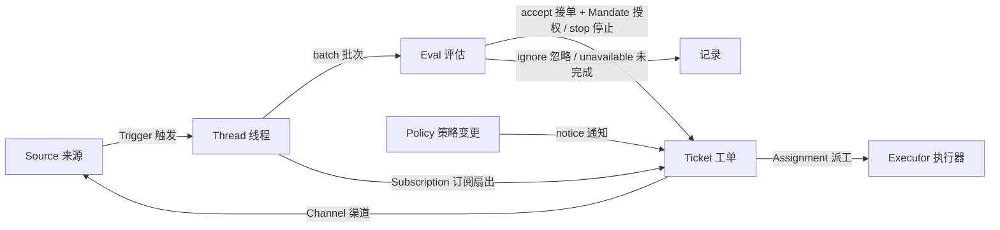

# 01 · 总览：它是什么，如何思考

> 依据上游 `README.md`、`docs/000-philosophy.md`、`docs/001-domain.md`、`docs/002-authorization.md`、`docs/003-execution.md` 与 `SETUP.md` 整理。

## 1. 项目定位

`dsh-superagent` 是一个**面向单个 GitHub 仓库的主动式编码智能体**，以 [DeepSeek Harness](https://www.deepseek.com/en/harness/)（DSH）bundle 的形式发布。它监听 GitHub，也可以选择监听 Feishu；当名单内的人向它提出请求，或者团队写下的主动规则命中时，它创建一个工单（Ticket），在独立的 DSH Session 和独立目录里完成工作，最后回到原对话交付结果，例如一个 pull request。

它同时是“一种与智能体协作的工作方式”，而不只是一个工具。上游把产品原则压缩成一句话：

> **Take as little human attention as possible, and give as much value as possible.**
> 占用尽量少的人类注意力，给出尽量多的价值。

这句话不是口号，而是可检查的设计约束：每条消息、每个通知、每个问题、每个设置项、每个面板元素、每段文档都要证明自己带来的价值大于消耗的注意力，否则就删掉。

### 它不是什么

- 不是独立的常驻服务：没有自己的 Web 服务器，而是作为 DSH 插件运行在专用 profile 里，使用 DSH 的 Web 服务和 Session。
- 不是通用多仓库平台：一个部署只监听一个 GitHub 仓库，且只支持 github.com，不支持 GitHub Enterprise Server。
- 不是无授权的“自动编程”：只有名单内的人显式请求，或团队启用的规则在 `auto` 模式下命中，才会真正执行。
- 不是生产级产品：README 明确声明这是研究代码，可能含 bug，编码风格与工程实践可能不一致。

### 运行形态

一个典型部署包含：

1. 一个独立的 DSH profile（文档中叫 `superagent`），从 DSH 的 Web profile 模板创建，加载本 bundle，默认在 `127.0.0.1:3082` 提供面板；
2. 一个专用 GitHub 账号，通过单独的 `gh` 包装器（`GH_CONFIG_DIR` 指向独立配置）行动；
3. 可选的 Feishu 自建应用与 bot，通过只允许 bot 身份的 `lark-cli` 配置行动；
4. 一个状态目录（`stateDir`），保存 SQLite 数据库、锁、命令 shim、git 配置和默认的工单目录。

部署机需要 Node.js 22.19+ 或 24+、pnpm、git 2.32+、Python 3.8+、tmux、GitHub CLI 2.48+，以及可用的模型 provider。

## 2. 设计原则

上游 `docs/000-philosophy.md` 把原则分成“对智能体的要求”和“对设计的要求”。

### 对智能体

| 原则 | 含义 |
| --- | --- |
| 只在被请求或被书面规则允许时行动 | 请求必须直接指向智能体，且来自团队允许的人；主动工作必须有团队写下的规则，并先在只记录不执行的 `observe` 模式验证 |
| 只在人必须行动或结果可用时说话 | 确认一次并说明要做什么；工作中保持安静；结果就绪、需要决定或无法完成时才再次发言；消息短，并回到请求发生的对话 |
| 一次只问一个具体问题 | 通过结构化字段提出，让问题真正到达人，而不是埋在长报告里 |
| 按影响停下，而不是按工作量停下 | 局部改动做到可评审的结果；需要设计决策的改动带着明确问题停下 |
| 诚实报告 | 草稿标记为未完成，失败就说失败，绝不为避免提问而绕过限制 |

### 对设计

| 原则 | 含义 |
| --- | --- |
| 少概念 | 只有领域概念及其具体实现；业务需求要么成为某个概念的属性，要么成为提示词，不为它新增概念 |
| 少设置 | 一个默认值适用于几乎所有团队时，就不做成设置；团队用自然语言描述的行为写成提示词，而不是设置项 |
| 面板只显示需要人的东西 | 首先列出等待人的事项；健康状态不占空间 |
| 文档按顺序读 | 每篇编号文档只依赖更早的文档，读者不会遇到尚未引入的概念 |

### 责任模型

上游把责任明确交给 operator：智能体用团队每天看到的账号发言、开 PR、发消息；每条消息都消耗同事的注意力。因此：

- **从小处开始**：先短名单、主动工作只记录；看起来正确后再扩大；
- **为减少噪音而调**：智能体吵的时候，缩短/收紧提示词或暂停它，而不是增加解释性消息；
- **不要用它制造数量**：批量 PR、广播消息和忙碌工作消耗团队多于产出；
- **为它说的话负责**：读它在自己名下发布的内容，发现错误就改提示词。

## 3. 两个角色：主 Session 与 Executor

系统把“路由”和“执行”分成两个 DSH Session，并用不同 agent preset 与工具集隔离。

| 维度 | 主 Session（orchestrator / router） | Executor Session（worker） |
| --- | --- | --- |
| 职责 | 评估候选、路由请求、转发报告、维护订阅、回复人 | 读上下文、判断范围、实现、验证、交付 |
| 是否读代码 | 除主动评估的只读上下文外，不读代码、详细日志或技术讨论 | 读代码、改代码、跑测试、开 PR |
| 技术决策 | 不做；不替 worker 设计方案或解决 blocker | 自己做；在授权范围内选择方案 |
| 工具 | 14 个应用工具（读/路由、工单、重评估、评估、回复、配置）+ DSH 基础工具 | 6 个应用工具（读、确认、报告、线程相关）+ 工作工具（文件、搜索、shell、job、web、skill、todo、subagent） |
| Preset | `dsh-superagent-router`（5 秒 shell/job 等待上限，无写文件、无 subagent） | `dsh-superagent-worker`（5 秒 shell 转后台，含工作工具；subagent 用 DSH `standard`） |
| 关键约束 | 不等待：报告、候选、后台任务结束会自动作为消息到达 | 一个工单一个 Session（`worker-<ticket id>`）和一个目录；turn 结束后台工作最多 30 分钟 |

这种分工的直接收益是：主 Session 的上下文不会被代码细节污染，能持续快速处理新候选；worker 的上下文专注于一个工单，不会被其他工单的讨论干扰。代价是两套提示词、两套工具和一套跨 Session 的消息/状态同步机制。

## 4. 领域模型

上游 `docs/001-domain.md` 用 11 个概念描述整个系统，并明确规定代码、工具、面板和文档只使用这些术语。

| 概念 | 定义 | 关键规则 |
| --- | --- | --- |
| **Source 来源** | 事件流。Source kind 是可复用实现，Source instance 是一份配置 | 保存读取位置和自己的 bot 身份；定义什么算事件；在进入领域前丢弃自己的消息和不在监听范围的事件；把事件翻译成 Thread 和 Channel 地址 |
| **Trigger 触发** | 一个不可变事件，带来源自己的元数据（如 actor） | 属于一个或多个 Thread；同一 Trigger 接受两次只创建一个 Ticket；是审计与幂等的单位 |
| **Thread 线程** | 按时间排序的 Trigger；由 Source 定义哪些 Trigger 属于同一线程 | 同一时刻最多一个 Eval；可以有多个 Ticket；保存订阅、运行中的 Eval 和 Decision 历史 |
| **Correlation 关联** | 一个 Trigger 所属多个 Thread 之间的关系 | 只增加上下文，不路由 |
| **Channel 渠道** | Thread 的写侧；地址格式由 Source 定义 | 一个 Thread 可有多个 Channel；一个 Ticket 持有一组 Channel；确认、回复、PR、review 都走这里 |
| **Policy 策略** | 版本化的评估规则，以及每个 Source 的部分：谁能发起工作、名单如何同步、哪些 bot 可产生候选 | 策略版本覆盖规则、accept mode 和 Source 部分；影响活动工单的变更会作为 Input 送达，但不撤销已有 Mandate；不同 Source 的身份绝不互相映射 |
| **Eval 评估** | 对一批 Trigger 的判断，分 gate 与 assessment 两层 | 输入是 Trigger 批次、Thread 快照、该 Thread 上的所有 Ticket（含已结束）和当前 Policy；输出 Decision；不持有状态 |
| **Mandate 授权** | 一次 accept 授予的东西：Policy 版本、范围、强度、命中的规则、发送者身份、接收方式 | 不可变；扩大范围意味着新 Ticket；Ticket 结束不撤销 Mandate；只有人的 stop 或 Policy 失效才撤销；已结束 Ticket 恢复前要重新校验 |
| **Ticket 工单** | 授权的单位 | 只有 Eval 能创建；引用 Mandate；持有 Channel 和 Input；open → ended，人的消息可恢复（除非被人 stop）；定义自己的状态，不跟随 Executor |
| **Assignment 派工** | 一个 Ticket 与一个 Executor 实例的绑定 | 一个 Ticket 可先后有多个 Assignment；pending → running → ended，独立于 Ticket；只有最终报告能在 Executor 侧结束 Ticket |
| **Subscription 订阅** | Ticket 与 Thread 的多对多关系，由 Thread 持有 | 匹配的 Trigger 无差别扇出给所有活动订阅工单；人的消息到达工单后不再走 Eval；已结束工单保留订阅，人的消息可在同一 Mandate 下恢复；bot/CI 不唤醒已结束工单；被人 stop 的工单不再接收任何东西 |

**人不是领域概念。** Trigger 只携带 Source 给出的 actor 标识；允许名单是 Policy 中该 Source 的部分，使用该 Source 的身份体系。“同一个人在不同 Source 上有不同账号”是提示词里的文本，不是代码里的实体。

**Executor 在领域之外。** Executor、它的 Session 和目录通过 Assignment 这个端口与领域相连。

### 聚合与写入者

- Source 持有读取位置；
- Thread 持有订阅、运行中的 Eval（串行，期间到达的 Trigger 合并进下一批）和 Decision 历史；
- Ticket 持有 Assignment、Channel、Input，并通过 id 引用 Decision；
- Trigger、Thread、Decision、Ticket、Assignment 的唯一写入者是 Engine（Source 只能通过 `SourceContext` 写自己的 meta 和读取位置）。

## 5. 一个请求的完整生命周期

以“GitHub 上有人 @ 智能体，请它改一个按钮文案”为例：

1. **Source 收取**：GitHub Source 轮询通知或已订阅的 Thread，把评论翻译成 Trigger（稳定的 Trigger id、Thread 引用、actor、`human`、`addressed: 'mention'`、文本、Channel 地址、meta）。自己的消息、仓库外的事件、未监听的 scope 在进入领域前被过滤。
2. **Engine.receive**：在一个事务里存储 Trigger（重复则返回 duplicate），记录 disposition，挂到 Thread 与 correlation，扇出给订阅的 Ticket；除非人的消息已经到达某个 Ticket，否则把它排入主 Thread 的 Eval。
3. **Eval / Gate**：确定 strength。名单内且 @ 智能体 → `explicit`；名单外但在已有 Ticket 的 Thread 上跟进 → `inferred`（除非准入表把它设为 explicit）；不符合条件 → `not admitted`。`off` 模式下推断候选直接不产生；`observe` 模式下评估但不执行；`auto` 模式下评估通过才执行。
4. **Assessment（主动候选）**：主 Session 用 `orchestrator_eval` 读取有界的 Thread 窗口和仓库上下文，用 `orchestrator_eval_decide` 提交判断：每条启用规则恰好一条 `rule_assessments`，加上 direction（是否请求实现、目标是否有依据、是否仍需设计决策）和证据。验收要求“有实现意图 + 目标已确定 + 无设计决策 + 至少一条规则命中 + intent_evidence”。
5. **Decide / accept**：Engine 在同一事务里创建 Ticket、Mandate、第一个 Assignment、订阅和确认消息。确认消息通过 Outbox 排队，按 Ticket + 会话有序发送。
6. **Assignment / launch**：`launch` effect 执行 prepare 命令（典型是 `git worktree` 创建 checkout），创建 `worker-<ticket id>` Session，把工单分配文本和来源 Trigger 卡片交给它。
7. **Worker 执行**：worker 读上下文、确认请求（`orchestrator_ack`）、实现、验证、提交、推送、开 PR；通过 `orchestrator_report` 报告 progress/ready/blocked/failed/dropped；开 PR 后 `orchestrator_report progress` 绑定 PR。
8. **交付与跟踪**：主 Session 把 ready 报告送到原对话；Ticket 跟随它开的 PR。PR 合并/关闭后，Ticket 在满足条件时结束；聊天渠道收到一条最终通知，GitHub 上 PR 自己显示结果。
9. **订阅继续**：Ticket 结束后仍保留 Thread 订阅。人后续在同一 Thread 发言，会直接到达该 Ticket 的 worker（不经过 Eval），在同一 Mandate 下恢复；bot/CI 不会唤醒它。

### 工单阶段（决定面板标签）

每个打开的 Ticket 只有一个阶段，按以下顺序取第一个匹配项：

| 阶段 | 条件 | 面板标签 |
| --- | --- | --- |
| person / delivery | 向 Executor Session 投递 Input 失败，正在按 2 秒 → 最长 1 分钟退避重试 | Input undelivered |
| person / answer | 存在 Attention | Awaiting answer |
| person / review | 最新 Report 是 `ready` | Awaiting review |
| person / blocked, failed | 最新 Report 是 `blocked`/`failed`，且此后没有人的消息到达 | Blocked / Failed |
| working / queued | 没有 Assignment，或有 pending Assignment | Queued |
| idle | 最新 Report 是 `waiting`，或 Assignment 已结束 | Waiting for a Trigger |
| working | 其他 | Working |

`person` 阶段意味着没有人的输入就无法继续；`idle` 意味着本轮已结束但没有未决问题，订阅 Thread 上的新 Trigger 可以继续它。

## 6. 被拒绝的概念：设计成熟度的证据

上游专门维护了一张“Rejected concepts”表。它比“有哪些概念”更能说明设计取舍：

| 被拒绝的概念 | 原因 |
| --- | --- |
| Principal / Membership 实体，或跨 Source 身份映射 | 人是 Trigger 元数据；名单是 Source 的策略部分；跨 Source 映射只是提示词文本 |
| Eval 自己调度延迟 Trigger | 需要等待的条件本身就是一个 Source；Eval 不应反向依赖 Source |
| Waiting / revoked Eval 状态 | 等待属于 Source；超时的 Eval 重新排队或记为 `unavailable` |
| “每个 Thread 最多一个活动 Ticket” | 一个 Thread 可以承载多个独立工作；评估通过 Ticket 列表避免重复 |
| “向 Ticket 追加”的 Decision | 追加是订阅扇出，不需要 Eval |
| 对订阅做准入检查 | 订阅覆盖整个 Thread；Mandate 把授权与上下文分开 |
| 让关联去路由 | 订阅负责路由；关联只增加上下文 |
| Ticket 状态跟随 DSH Session | Ticket 可以被交接、恢复、由多个 Executor 执行，必须有自己的状态 |
| Executor 声明“人要求停止” | 只有 Eval 能决定 stop 的强度 |
| Policy 变更时取消运行中的 Ticket | 取消会留下半成品；应该记录变更并送达 |
| Executor 失败/阻塞时锁死它的全部工具 | 会拒绝人直接在 Session 里工作，也会拒绝恢复后的报告；暂停自动输入就够了 |
| 从报告自由文本推断“在等人” | 分类需要结构化事实；Executor 通过结构化字段提问 |

## 7. 与论文的关系

仓库描述是 “Towards a More Autonomous Agent System”，与上游论文 *Exploring Super-agent Design: Towards a More Autonomous Agent System* 同名主题。README 明确说明：

- 这是从团队日常开发中长出来的代码，大量工程由编码智能体完成；
- 为公开发布做过适配，因此与内部版本、论文描述的实现在细节上并不相同；
- 论文中的一些设计是未来方向，原型并未实现。

因此本归档只研究**仓库实际实现**，不把论文中的主张当作已实现能力。若需要论文与仓库的逐项对照，应另行做版本化对照，而不是从 README 推断。

## 8. 一句话总结

它用“少概念、少设置、少说话”的约束，把“主动式编码智能体”拆成可审计的领域状态机（Trigger → Eval → Ticket → Assignment）和两个职责分离的 DSH Session；可靠性来自持久化状态与副作用队列，而不是来自更复杂的调度框架。
