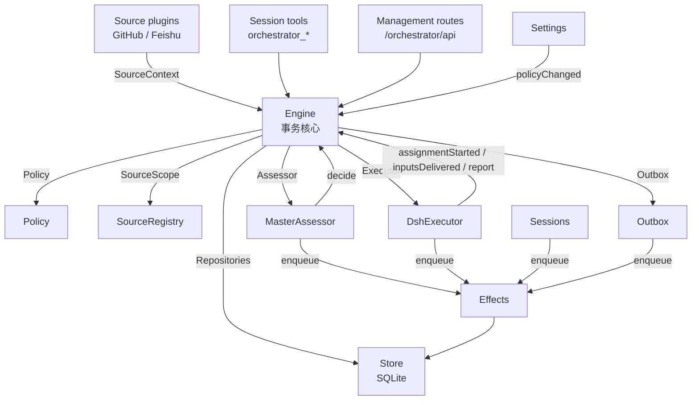

# 02 · 架构：从组合根到执行器

> 主要依据 `docs/007-architecture.md`，并对照 `src/core/engine.ts`、`src/core/ports.ts`、`src/app/runtime.ts`、`src/app/store.ts`、`src/app/effects.ts`、`src/app/outbox.ts`、`src/sources/kind.ts`、`src/executor/dsh.ts`、`src/app/sessions.ts` 等实现整理。

## 1. 总体分层

系统可以分成五层，依赖方向大体是“外层依赖内层”：



| 层 | 模块 | 职责 |
| --- | --- | --- |
| 领域核心 | `src/core/` | 纯领域类型、规则、Engine 与五个内部部件；不做 I/O，除 Node 的哈希外不依赖外部 |
| 应用层 | `src/app/` | 组合根、Store、Settings、Prompts、Sessions、Effects、Outbox、HTTP 路由、面板视图、工具适配、评估器 |
| 执行器 | `src/executor/` | DSH Executor：Session/目录生命周期、worker slot、后台工作、输入投递、报告 |
| 来源 | `src/sources/` | SourceKind 协议、注册表、GitHub 与 Feishu 实现、轮询与上下文读取 |
| 基础设施 | `src/infra/` | CLI 传输、进程环境、健康板、文本/路径工具 |
| 浏览器面板 | `src/client/` | React 面板、路由、设置表单、Markdown、i18n |
| 插件入口 | `src/index.ts`、`src/sources/github.ts`、`src/sources/feishu.ts` | 三个 DSH 插件入口（主插件、GitHub Source、Feishu Source） |

**核心原则：** 领域核心不认识 GitHub、Feishu、DSH 或 SQLite；它只认识端口（`Repositories`、`Policy`、`SourceScope`、`Assessor`、`Executor`、`Outbox`）。适配器把外部世界翻译成端口调用，把结果翻译成卡片、视图和消息。

## 2. Runtime：组合根

`Runtime`（`src/app/runtime.ts`）是唯一的组合根，自身不含领域规则。构造顺序大致是：

1. 创建/锁定 `stateDir`（`proper-lockfile`，30 秒 stale 检测），防止两个进程迁移或写同一个数据库；
2. 打开 `Store`（SQLite），读取/生成 `masterId`；
3. 构造 `Setup`、`Prompts`、`Commands`、`SourceRegistry`、`Effects`、`Outbox`、`Settings`、`Sessions`、`Engine`、`DshExecutor`、`MasterAssessor`、`Passes`；
4. 注册管理 API 路由和 SourceHost 服务；
5. 启动时注册 Session/Executor hook，确保主 Session 存在，启动 Policy sync，恢复被中断的 Assignment，启动 pass 与 effect 处理；
6. `ready` 表示启动完成。

关闭时：取消 turn，等待 pass、effect 和 agent，恢复进程环境，关闭 Store，释放锁。任一构造失败都会关闭 Store 并释放锁。

**SourceHost / SourceContext。** Source 插件通过 Cordis 的 `orchestrator` 服务注入 Runtime，但只看到窄接口 `SourceHost`：注册表 + `context(kind)`。kind 自己的代码只看到更窄的 `SourceContext`：部署与命令、就绪/配置/问题、配置、`receive`、`atomic`、类型化 state、Thread 读与元数据写、Ticket 读与绑定/关闭、Trigger 读、`notify`、健康上报。这样 Source 无法直接调用 Engine 的任意方法，只能走被授权的入口。

## 3. Engine：单事务写入口

`Engine`（`src/core/engine.ts`）是 Trigger、Thread、Decision、Ticket、Assignment 的**唯一写入者**。它的所有方法都是同步的；每个命令在一个事务里修改聚合；`evaluateDue` 对每个 Eval 或 Ticket 使用独立事务；端口在事务内入队外部工作，适配器在提交后执行。

Engine 把命令委托给五个内部部件，依赖方向单向：

| 部件 | 职责 | 依赖 |
| --- | --- | --- |
| `Intake` | Source 的 Trigger：只存一次、记录 disposition、挂到 Thread 与 correlation、扇出给订阅 Ticket；除非人的消息已到达某个 Ticket，否则排入主 Thread 的 Eval | Tickets |
| `Evals` | Thread 的 Eval：批次、gate 的 strength/actor/basis、deadline 与 pause 平移、超时重排、候选、replay、hand-back、Policy 变更重排、Decision（accept/stop/ignore/unavailable） | Tickets |
| `Tickets` | 工单生命周期：从 accept 创建 Mandate/订阅/首个 Assignment、跟随 Thread 与关闭、绑定/上下文 Thread、Input/note、恢复与拒绝、retry/restart/stop/end、丢弃订阅、Policy 变更通知 | Replies |
| `Assignments` | Executor 的事实：Assignment 开始、Input 送达/失败、重启中断、worker Report 及其问题 | Tickets, Replies |
| `Replies` | 通过 Outbox 的 Channel 写入：确认、回答、结果、attention 消息，各自按允许规则 | 无 |

调用者只拿到角色的 `Pick` 接口：`EngineForSources`、`EngineForMainSession`、`EngineForPeople`、`EngineForSettings`、`EngineForExecutor`。例如 Source 只能 `receive`、`bindThread`、`threadClosed`；主 Session 不能直接 `stopTicket`（那是人的操作）；Executor 不能创建 Ticket。

### 命令与事实

- 请求型方法用祈使动词命名：`stopTicket`、`bindThread`、`retryTicket`，可能被拒绝；
- 适配器上报的事实用品红色过去式：`assignmentStarted`、`deliveryFailed`、`turnEnded`；
- 查询用名词：`candidate`。

### 共享谓词

几个谓词保证规则一致：

- `waitsForPerson`：最新 Assignment 报告 `blocked`/`failed`，且此后没有人的消息；
- `followupOwners`：仍在负责某条人类跟进的 Ticket（活动的，或未被人 stop、等待恢复的已结束工单）；
- `settled`：Decision 是否解决了请求（stop/unavailable/routed/refused-stop 不算）；
- `ticketStage`：003 文档中的阶段表。

### 领域事件

变更后 Engine 发出 `DomainEvents`：`trigger.received`、`eval.started`、`decision.recorded`、`ticket.created`、`ticket.resumed`、`ticket.ended`、`assignment.started`、`assignment.ended`、`thread.subscribed`、`thread.unsubscribed`、`trigger.requeued`、`policy.changed`。Runtime 只消费其中一部分（工单结束、Trigger 重排、取消订阅、人类跟进、PR 结束通知）；其余事件目前没有消费者——这是可扩展点，也说明事件总线不是核心耦合点。

## 4. 持久化：一个 SQLite 文件

`Store`（`src/app/store.ts`）打开 `<stateDir>/orchestrator.sqlite`，schema 版本 11，从 10 迁移。数据库只由 Store 打开；Runtime 先加目录锁再打开数据库。

| 表 | 内容 | 写入者 |
| --- | --- | --- |
| `trigger` | 每个 Trigger，时间统一为 `Date#toISOString` 形式 | Engine |
| `disposition` | Trigger 去向：filtered、Eval/Decision、扇出/附着的 Ticket、requeue、hand-back、ack/answer | Engine |
| `trigger_thread` | Trigger 属于哪些 Thread，带时间和“是否人所写”；按时间+id 分页 | Store（随 Trigger） |
| `thread` | 订阅、上下文 Ticket、排队 Trigger、运行中 Eval、连续过期计数、`meta`；生成列 `active`/`subscribed` | Engine；Source 写 meta |
| `ticket` | Ticket 的 Mandate、origin、execution、Assignment、Channel、Input、跟随的 Thread；生成列 `open`/`active` | Engine |
| `decision` | 按 Thread 保存 Decision | Engine |
| `effect` | 副作用队列：kind+key、payload、顺序、失败次数、错误、到期时间 | Effects；迁移会入队旧数据 |
| `outbox` | 每条 Channel 消息的回执：id、Ticket、status（pending/sent/dropped）、丢弃时间与原因；生成列 `dropped` | Outbox |
| `kv` | 其他所有记录：schema、设置版本、提示词版本、主 Session id、Session 提示词历史、Source 读取位置、显示名等 | 各记录的所有者 |

**生成列**从行内 JSON 计算，为空表示不在集合中，并对集合建索引，使 pass 只读活动工作。

**迁移策略：** `SCHEMA_VERSION` 只增不减；打开比当前新的数据库会拒绝启动；旧于 `OLDEST_SCHEMA`（10）也拒绝；10 → 11 在启动时一次性迁移。文档明确说“新版本迁移过的数据库不能被旧版本打开”，回滚需要升级前备份。

**没有清理机制：** `trigger`、`disposition`、`decision`、已结束 Ticket/Thread、outbox 回执、设置/提示词历史、每个 Session 的提示词修订、Source 的 per-Thread 记录都会无限增长。这是研究原型的已知债务。

## 5. 副作用队列：先落库，再执行

`Effects`（`src/app/effects.ts`）是持久化副作用队列。命令在事务内调用 `enqueue(kind, key, payload)`；只有事务提交后才开始执行。相同的 kind/key 只有一行；重复入队会替换 payload、让任务立即到期，但不改变队列位置。

| kind | 处理器 | 做什么 | 并发 | 重试 |
| --- | --- | --- | --- | --- |
| `assessment` | MasterAssessor | 把候选卡片送入主 Session 的 turn，然后告诉 Engine 已送达（开始 deadline） | 4；暂停时为 0 | 2s 起，翻倍至 60s |
| `launch` | DshExecutor | 启动 pending Assignment：prepare 命令、Session、分配消息 | 空闲 worker slot；暂停时为 0 | 瞬时 provider/网络失败 5s 起翻倍至 300s，最多 3 次；其他失败（含 prepare 失败）直接失败工单；被暂停/slot 满时 5s 后再试 |
| `delivery` | DshExecutor | 按顺序把等待中的 Input 交给运行中的 Assignment | 4；暂停时为 0 | 2s 起翻倍至 60s；等 slot 时 2s 后再试 |
| `relay` | Sessions | 把 worker 报告/问题或人类跟进送入主 Session 的 turn | 1，按队列顺序 | 2s 起翻倍至 60s |
| `notice` | Sessions | 向主 Session 注入通知但不唤醒它 | 1，按队列顺序 | 2s 起翻倍至 60s |
| `reply` | Outbox | 通过 Source 发送 Channel 消息，排在同 Ticket 同会话的未失败消息之后 | 1；暂停时为 0 | 5s 起翻倍至 300s；Source 关闭或排在后面时 5s 后再试 |

行为细节：

- 每种 kind 有自己的健康条目；连续失败 3 次后报 error（`delivery` 的失败显示在工单上，不报健康）；
- `relay`/`notice` 保序；失败会挡住同 kind 后续；
- 抛出 `Later` 表示“现在不能做”（暂停、slot 满），不算失败，按初始延迟重排；
- `start` 在 setup 后开始；`drain` 在关闭时停止接受新任务但保留等待行；
- 同一 kind/key 的 payload 更新会递增 generation，防止运行中的旧尝试删掉新 payload。

## 6. Outbox：消息回执与幂等

`Outbox`（`src/app/outbox.ts`）是 Engine 的 `Outbox` 端口，也是回执的唯一写入者。`send` 在一个事务里保存消息回执并入队 `reply` effect；effect 通过 `SourceRegistry.send` 发送。

- **回执去重：** 消息 id 永不重复入队；同一条消息不会因重试而发两次。
- **顺序：** 同一 Ticket 发往同一会话的消息按入队顺序发送；前面的消息失败 3 次并显示为问题后，后面的才继续。其他 Ticket 或非 Ticket 消息不等待。
- **等待与丢弃：** Source 关闭时消息等待；Source 不再监听该会话、会话被删除/锁定、消息被撤回时标记为 dropped，并保留时间、原因和所属 Ticket，永不重发。回复已删除的 review comment 会退回 PR 会话。
- **幂等发送：** Source 的 `send` 必须用消息 id 作为幂等键（GitHub 用隐藏标记，Feishu 用幂等 key）。发送可能“远端已收到但本地失败”，所以重试不能产生重复。

## 7. Source：插件协议

`SourceKind`（`src/sources/kind.ts`）定义了一个 Source 需要提供什么：

| 能力 | 说明 |
| --- | --- |
| 身份 | 稳定的 `kind` id、标题、描述 |
| 配置 | Zod schema、面板字段（text/switch/select/number/rows/fact）、默认值 |
| 健康 | 声明自己拥有的健康条目；注册时在 HealthBoard 上认领，重复或保留名（如 `sync:`）会被拒绝 |
| `scope` | 根据 Trigger meta 和配置判断是否监听、是否观察未 @ 的消息、对应准入表的哪一行 |
| `channel` | `allowed(address, config)`、`send(message)`（幂等，返回 `sent`/`gone`）、`link(address)` |
| `threadContext` | 给评估读取有界 Thread 上下文：`messageId`、`read(part, cursor)`，可选 `images`/`image` |
| `find` | 把 `#12`、消息 id、URL 等引用映射到 Thread key 或搜索词 |
| `repliesTo` | 不联网地从 Trigger 推导它回复的 Trigger id |
| `policy` | 允许名单、准入表行、可选 bot 名单、可选外部名单同步（如 Feishu 群成员） |
| `refreshLabels` | 重新解析显示名（如群名、账号名） |
| `environment` | 注册执行环境变量，并给出每个 Ticket 的值 |

`SourceRegistry` 持有已注册 kind 和已存实例，实现 Engine 的 `SourceScope`。它负责校验配置、生成 Policy 部分、判断 Channel 是否允许、提供 Thread 上下文、发送消息、解析链接、合并执行环境变量、搜索和刷新标签。无效的已存配置会禁用该实例，而不是让整个进程崩溃。

### GitHub Source

`src/sources/github.ts`（459 行）+ `github-trigger.ts` / `github-pull.ts` / `github-read.ts` / `github-channel.ts`：

- 轮询智能体账号的 GitHub 通知；
- 轮询打开 Ticket 的 PR（含 CI）和已订阅 Thread；
- 可选“接收仓库内所有新 Issue / 新 PR / 评论 / 默认分支 CI”的开关（`observeIssues`/`observePulls`/`observeComments`/`observeCi`，默认关）；
- 把评论、review、Issue body、CI 变化翻译成 Trigger；
- PR 规则：哪些 PR 跟随（`claimPull`/`observePull`）、关闭上报、合并/关闭时发一条聊天通知；
- Channel 发 Issue 评论和 review thread 回复；
- Thread context 分页读取 Issue/PR 对话；
- 接受 `#12`、`12` 或 GitHub URL 搜索；
- 注册 `DSH_SUPERAGENT_GITHUB_*` 环境变量（仓库、账号、提交邮箱、Issue/PR 编号、PR head ref）。

注意一个易错点：编辑已有 Issue body 加上 @ 不会被收到；必须新发评论。这是 GitHub 通知语义，不是实现缺陷。

### Feishu Source

`src/sources/feishu.ts`（139 行）+ `feishu-trigger.ts` / `feishu-loops.ts` / `feishu-read.ts` / `feishu-channel.ts` / `feishu-image.ts`：

- 实时事件消费（`lark-cli event consume`）；
- 群历史补收；
- 订阅 Thread 的轮询；
- 群配置支持“仅 @”或“全部消息”；可接收私聊；可配置“其他群仅 @”；
- 名单同步：可指定一个群，把成员同步为允许名单（启动时和手动 Sync）；
- Channel 发话题回复；
- Thread context 读取消息、根消息、父消息、图片；
- 接受 `om_…` 消息 id 搜索；
- 注册 `DSH_SUPERAGENT_FEISHU_BOT` / `DSH_SUPERAGENT_FEISHU_CHAT` 环境变量。

Feishu 的复杂度明显高于 GitHub：实时事件、历史补收、轮询三条路径共享一个 Trigger 规则；bot 身份和用户身份的隔离必须由 CLI 配置保证；图片读取需要 DSH 的 attachment 能力。

### 轮询与游标

`src/sources/poll.ts` 提供共享逻辑：

- `POLL_HORIZON_MS` 和 `cursorAt(started)`：时间戳游标回退 5 秒，容忍远端迟到写入；
- `polled`：判断一个 Thread 是否仍值得轮询（活动订阅，或最后一个 Trigger / Ticket 结束后两周内）；
- `pollThreads`：对每个 Thread 独立轮询，把失败记录为该 Thread 的 `pollError`，而不是让整轮失败。

**游标推进规则：** 先成功 `receive` 所有覆盖的 Trigger，再推进游标；中断的一轮保持游标不变；稳定的 Trigger id 使重放安全。

## 8. Executor：一个工单一个 Session 和一个目录

`DshExecutor`（`src/executor/dsh.ts`，673 行）是 Executor 端口的实现。

### 创建与准备

- Session id：`worker-<ticket id>`；目录名：`<worktree name>-<ticket id 前 12 位>`，默认在 `<stateDir>/work` 下，可由 Execution 设置覆盖；
- 第一次 Assignment 前，如果目录不存在，执行 prepare 命令一次。命令用 `sh` 在 execution root 运行，最长 10 分钟；没有 prepare 命令就从空目录开始；
- prepare 失败立即失败工单并记录输出；重试或人的消息会再次尝试准备；
- 典型 prepare 是用 `git worktree` 从本地 clone 创建 checkout；PR 分支最后一段等于 `DSH_SUPERAGENT_NAME` 时自动绑定到工单。

### Worker slot 与并发

- Ticket 从 launch 开始（含 prepare）或从唤醒 idle worker 的投递开始持有 slot，并贯穿整个 turn；
- `maxWorkers` 限制这些 slot；额外留 1 个 slot 给人消息或状态请求，保证人不会被新工作饿死；
- 新工作按普通 slot 排队；launch 并发，prepare 慢只延迟自己的工单。

### Turn 与后台工作

这是一个值得借鉴的细节：

- worker 的 shell 前台命令 5 秒后自动转后台；主 Session 同样 5 秒；这样长命令不会阻塞“下一条人的消息在下个 step 被取走”；
- turn 结束时如果还有 shell job 或 subagent 在跑，工单保持 worker slot 并显示 working，而不是 waiting；后台任务结束会在同一 slot 唤醒 worker 并带回结果；
- 每个 turn 结束后台工作最多再跑 **30 分钟**；到点杀 shell job、报告 waiting，报告里带 worker 最后的话和被杀的 job；subagent 允许继续；
- 交接给人（ready 报告、提问、blocked/failed）立即释放 slot；
- 交接时 subagent 停止；shell job（如给人试用的服务器）可以继续到 Assignment 结束，不占 slot，也不受 30 分钟限制；它们结束不会唤醒 worker，worker 下次 turn 自己读结果；
- Assignment 结束时杀 shell job、释放 subagent，丢弃它们唤醒的 turn；
- 插件停止/重启走同一 shutdown 路径：每个 worker 的后台工作最多等 10 秒；进程重启直接结束；中断的 Assignment 用恢复说明重启。

### 失败与恢复

- 可传递的 provider/网络失败（HTTP 408/429/5xx、连接拒绝/重置/超时/DNS 等）先重试 3 次；launch 用 effect backoff，worker turn 用 15/30/60 秒的继续消息；prepare 失败不自动重试；
- 不可传递失败 → `failed`；`blocked`/`failed` 后工单不自动接收 Input，CI/bot 消息只记录不投递、不唤醒；
- 人的消息、非 blocked/failed 的报告或 retry 解除 hold；
- retry 结束当前 Assignment，在同一 Session、目录、分支、PR 上开新 Assignment；
- 重启时运行中的 Assignment 以“host restarted”结束，新 Assignment 带恢复说明，要求先检查目录、git 历史和 GitHub 再重复外部动作；等待/ready/blocked/failed 的 Assignment 保持，除非之后又收到 Input；
- 未取走的 Input 会被保留/重投；已取走但被取消/错误截断的，按“未读”处理。

## 9. 评估器：有界上下文 + 结构化判断

`MasterAssessor`（`src/app/assessment.ts`）让主 Session 评估主动候选：

- `orchestrator_eval` 返回上下文，不返回指令；
- `orchestrator_eval_read` 展开 Thread 的更多页、根消息、父消息或仓库文件；
- `orchestrator_eval_decide` 提交判断。

上下文预算（来自 007 文档）：

- Trigger 文本最多 4,000 字符；
- 相关 Ticket 最多 8 个（活动优先），附 `tickets_total`；
- Policy 版本；
- Thread 窗口：前 5 条 + Trigger 两侧各 5 条；普通消息最多 400 字符，紧邻两条最多 1,200 字符；被截断的消息带 `chars`；图片用 `images`；
- 其他已加载消息只给 50 字符 stub，可按 id 展开。

判断 schema 要求：

- `rule_assessments` 对每条启用规则**恰好一条**，`matched` 可为 false；
- `direction`：`implementation_requested`、`target_basis`（specified / existing-standard / undetermined）、`requires_design_decision`、`evidence`；
- accept 还要求 `intent_evidence`、至少一条命中规则、以及一个短的英文 `worktree_name`；
- `observe` 模式下，正评估被记录为 `ignore` + `would_accept`，不执行；
- `auto` 模式下才真正 accept。

这套结构把“模型判断”限制在可审计的字段里：布尔值、枚举、证据文本和逐规则理由，而不是一段自由文本。

## 10. Sessions、工具与 Preset

`Sessions`（`src/app/sessions.ts`）管理两个角色的 DSH Session：

- 创建 Session 时绑定角色模型；
- 跟随 agent 事件，注册提示词、技能和工具；
- `prompt` 每个请求 id 只投递一次；
- `relay`/`notify` 通过 effect 队列投递主 Session 消息；
- 每个模型请求绑定当前提示词版本，并持久化“该 Session 用过哪些版本”，限制 worker 可读的版本；
- 记录模型预算重试状态（`models` 健康条目）。

### 主 Session 的 14 个应用工具

| 用途 | 工具 |
| --- | --- |
| 读与路由 | `orchestrator_read`、`orchestrator_route` |
| 管理工单 | `orchestrator_ticket_retry`、`orchestrator_ticket_request_status`、`orchestrator_ticket_note` |
| 重评估 | `orchestrator_trigger_requeue` |
| 主动评估 | `orchestrator_eval`、`orchestrator_eval_read`、`orchestrator_eval_decide` |
| 沟通与取消订阅 | `orchestrator_reply`、`orchestrator_thread_unsubscribe` |
| 配置 | `orchestrator_settings_save`、`orchestrator_policy_sync`、`orchestrator_prompts_save` |

`orchestrator_route` 一次接受 1–20 个决策，逐项独立执行；一项被拒绝不影响其他项。

### Worker 的 6 个应用工具

`orchestrator_read`、`orchestrator_ack`、`orchestrator_report`、`orchestrator_thread_unrelated`、`orchestrator_thread_follow`、`orchestrator_trigger_handback`。

工作工具白名单 `WORK_TOOLS` 包含文件、搜索、shell、job、web、skill、todo、subagent 等；不包含向人提问/展示、修改 profile、在 worker slot 之外调度、启动/消息其他 Session、编辑外部文档的工具。工单结束后工具调用被拒绝。

### 等待上限

`noWait` 守卫拒绝主 Session 的以下行为：

- bash 命令在命令位置执行 `sleep`；
- `timeoutMs` 超过 30 秒；
- `job_output` 的 wait 超过 5 秒。

原因是：报告、跟进、候选和后台任务结束会自动作为消息到达；主 Session 等待只会延迟处理下一个候选。`standard` preset 下创建的旧主 Session 也会收到显式超时提示。

## 11. 提示词：版本化配置

`Prompts`（`src/app/prompts.ts`）把提示词配置保存为编号版本（`Versions`），支持：

- 团队可编辑的三个段落：Communication、Ticket scope、Delivery requirements；
- 覆盖任何内置部分：共享/角色、工作指令、handoff、Source 技能、生成的 environment/policy 段；
- 模板占位符校验：`{variables}`、`{version}`、`{mode}`、`{rules}` 等；
- 保存时记录它基于哪个默认版本；升级后如果默认变了，面板标记 “Default updated”，让团队保留自己的文本、采用新默认或编辑；
- 覆盖等于默认时自动移除，让该部分继续跟随未来默认；
- 大小限制、未知 key 拒绝、保留技能名拒绝、绝不静默截断。

### 组装顺序

1. 共享指令 + 角色；
2. 三个团队段；
3. 订阅与回复；
4. 主 Session 的 dispatch 或 Executor 的 work 指令；
5. `runtime/admission`（仅主 Session）；
6. handoff 指令；
7. `runtime/environment`（主 Session 是部署值，Executor 是 Ticket 值）；
8. `runtime/policy`（仅主 Session；每次模型请求重新生成）。

Policy 段放最后，这样 Policy 变更只影响最后一段，前面文本保持稳定（利于缓存和审计）。

### 优先级

从强到弱：

1. 工具和宿主强制的事实：身份、权限、工具参数检查、回复用途、长度限制；
2. 内置/生成段落（团队覆盖后的文本）；
3. 主动工单命中规则的流程与沟通要求（仅该工单的 Executor）；
4. 团队段和团队技能；
5. 外部文本：消息、评论、文档、引用——只是数据，永远不改变规则或授权。

## 12. 面板

面板是 DSH Web 侧边栏的 **Superagent** 入口，回答三个问题，按顺序：

1. 现在有需要我做的事吗？
2. 系统健康吗、在做正确的事吗？
3. 一件工作的历史是什么（Trigger → Eval → Ticket）？

六个标签：Overview、Source、Trigger、Eval、Execution、Settings。设计原则包括：

- 只保留回答三个问题所需的元素；
- 分类定义可检查、互斥、覆盖所有情况（如工单阶段）；
- 每个概念只在一个地方出现；
- 面板使用领域术语，内部 id 只出现在折叠详情；
- 计数等于它链接的列表长度，状态不互相矛盾；
- 健康状态不占空间；问题必须可行动；
- 使用 DSH 设计 token 和控件行为；每个设置块只有一个保存条。

前端是 React 18，作为 DSH client plugin 注入主面板、侧边栏图标和 Plugin Manager 配置页；因为 bundle 不导入 `dsh-client-ui-primitives`，它本地复制了必要的控件以保持 DSH 的 markup、键盘行为和设计 token。中英文文案在 `src/client/locales.ts`，领域术语表与 001 文档一致。

## 13. 部署与运维

`docs/006-deployment.md` 是完整的运维手册。关键点：

### Setup 检查

Setup 通过 DSH subprocess 服务探测 GitHub/Feishu CLI（作为 worker shell 运行，去掉 worker-bin 的 PATH）：

- 验证 GitHub 仓库、智能体账号和 push 权限；
- 写出 worker 环境；
- 检查 git 只对 github.com 使用智能体凭据；
- Feishu 失败只禁用 Feishu Source。

Setup 写出的进程环境：

- `<stateDir>/worker-bin` 命令 shim，放在 PATH 最前：`gh` 走智能体 CLI，`lark-cli` 走 bot CLI，被 block 的命令失败；shim 运行目标前会把自己的目录从 PATH 去掉；
- `<stateDir>/worker-gitconfig`：替换用户的 global/system git 配置，选择智能体 CLI 作为 github.com 凭据 helper，把 GitHub SSH 地址改写为 HTTPS，定义 Git LFS filter；不设置提交身份、不允许交互式凭据、移除 `GH_TOKEN`/`GITHUB_TOKEN`。

如果 `worker-bin` 或 `worker-gitconfig` 里有不是 dsh-superagent 写的文件，setup 会停止。工单目录所在 git 仓库如果自己配置了凭据/extraheader，工单会失败。

### 管理 API

面板使用的本地 HTTP API 也可被 agent 调用：`http://127.0.0.1:<port>/orchestrator/api/`，要求 `x-orchestrator-request: 1` 和 loopback Host，否则 403。文档承诺稳定的路由：

- `GET state`、`GET settings`、`GET sources`；
- `PUT settings/<block>`（带 revision）；
- `POST executor/pause`、`POST setup/check`、`POST policy-sync/<source id>`；
- `GET/PUT prompts`；
- `POST tickets/<id>/retry`、`POST tickets/<id>/stop`。

错误码：400 非法值/账号检查失败/固定拒绝/body 非法，404 不存在，409 旧 revision，500 其他。

### 服务脚本

`scripts/dsh-superagent` 是 Python 脚本，用 tmux 管理一个 DSH profile：

- `start` 启动 `dsh --profile superagent`（或 `dsh-<profile>`），最多等 1 分钟；
- `stop`/`restart` 请求优雅关闭，最多等 5 分钟；不 force-kill，不碰其他 tmux session；
- `status` 打印 pid、健康和 setup 问题；
- 退出码：0 正常；1 没运行/运行两份/无响应/runtime 报错（restart 可能修复）；2 某部件（Source、Policy sync）报错（restart 不修复）；3 等待 setup（restart 不修复）；
- `.artifacts/` 保存最近 20 份启动日志和控制文件；
- 支持 `--respect-stop`，让小时检查不会恢复用户有意停止的服务。

### 小时检查

文档建议在操作员自己的 DSH profile 里创建小时检查（不是 superagent profile），用固定提示词读取 `status`：0 沉默；2/3 报告但不重启；1 尝试 `--respect-stop restart`；仍失败则读最新日志并修。

## 14. 架构规则

上游用一组明确规则约束代码演进：

1. **窄依赖。** 每个类只接收它用到的接口，通常是其他类的 `Pick` 类型；Runtime 只以 `HttpHost`、`MainToolsHost`、`ExecutorToolsHost`、`ResourceHost`、`LinkHost`、`SourceContextDeps` 等窄接口传自己。
2. **导入方向。** `src/core` 除 Node 哈希外不导入外部，也不做 I/O；`src/sources` 不导入 `src/app`；面板只导入宿主侧类型和少数纯值模块。
3. **一种状态一个写入者。** Trigger/Thread/Decision/Ticket/Assignment → Engine；Source 读取位置和 Thread meta → 该 Source；设置 → Settings；提示词版本 → Prompts；effect 行 → Effects；outbox 回执 → Outbox；健康条目 → 认领它的部件（重复认领被拒绝）。
4. **请求与事实。** 请求用祈使动词、可能被拒绝；适配器上报用过去式、记录已发生的事实。
5. **类型化字段，Source 数据留在 Source。** Ticket/Mandate 的字段是类型化的；Source 不往 Ticket 上挂东西，它关于 Thread/Trigger 的信息放在 `meta`。
6. **固定拒绝。** 人和 agent 能触发的拒绝是 `UserError(code, values)`；管理 API 把 `missing` 映射 404，其他 400；面板按语言翻译每个 code。Setup 问题是 `SetupError` code，健康是固定 `HealthCode`。

这些规则由测试部分强制（见 04 文档）：模块表完整性、类 JSDoc、模型可见表面、本地化、样式、无 import cycle 等。

## 15. 一次完整数据流（以 GitHub 请求为例）

```text
GitHub 通知/轮询
  → github-trigger.ts 翻译为 Trigger
  → Engine.receive（一个事务）
      → trigger / disposition / trigger_thread
      → 扇出到订阅 Ticket（如有）
      → 否则排入 primary Thread 的 Eval
  → pass 调用 Engine.evaluateDue
      → Evals.start：gate 计算 strength/basis
      → 显式：候选卡片入队 assessment effect
      → 主 Session 收到候选，orchestrator_route accept
      → Evals.decide：创建 Ticket + Mandate + Assignment + Subscription + 确认回执
      → launch effect：prepare 目录、创建 worker Session、投递分配
  → worker 工作：读、改、测、提交、推送、开 PR、report
      → report 触发 relay / 更新 Ticket 状态
      → 开 PR 后 bindThread；GitHub Source 轮询 PR/CI
  → PR 合并/关闭
      → threadClosed：Ticket 结束（满足 followsDone）
      → 聊天渠道发最终通知；GitHub 上 PR 自己显示结果
```

## 16. 架构评价

**优点：**

- 领域核心与外部世界解耦彻底，端口窄，测试可以在内存仓库和模拟 DSH 宿主上跑完整 runtime；
- “单写入者 + 事务 + 持久化 effect”让重启安全和审计成为默认属性，而不是事后补丁；
- 两个角色的工具/提示词/preset 分离，减少了上下文污染和越权；
- Source 协议完整，cookbook 足够实现一个新来源；
- 文档本身就是架构的一部分（编号、只向后链接、模块/测试表完整性检查）。

**代价：**

- 概念密度高：11 个领域概念 + 5 个 Engine 部件 + 6 种 effect + 2 个角色 + 2 个 Source，理解成本不低；
- 大量规则写在提示词里，行为正确性依赖模型遵守；代码只强制其中一部分；
- 单进程 SQLite + 目录锁限制了水平扩展；
- 每工单一个 Session + 目录，资源消耗随并发线性增长；
- 研究原型缺少数据保留、备份自动化、权限隔离等生产运维能力。
