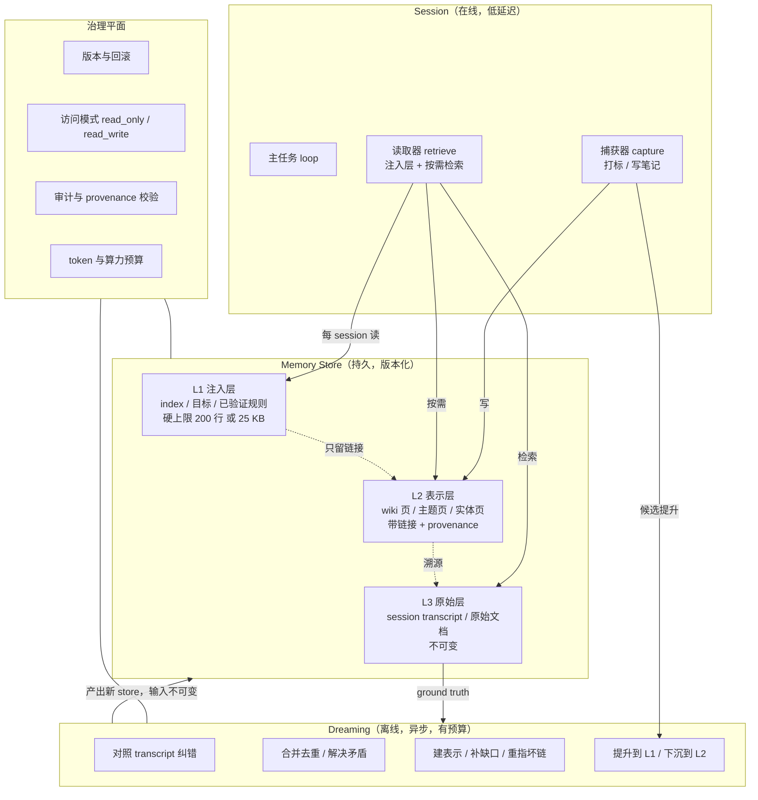

# 02 · 对后续 agent memory 系统设计的建议

> 本页把 [01](01-article-analysis.md) 中的原文事实转成**可施工的设计建议**。
> 每条建议标注依据强度：**[A]** 原文有直接实验/产品支撑；**[A-外部]** 原文链接的第三方/配套材料（非 Anthropic 评测，仅证明模式与接口可行）；**[B]** 由原文多条证据推出的合理设计；**[C]** 本文推断，需自行实验验证。
> 原文没有给出的信息（置信区间、dreaming 成本模型等）在 [03](03-claims-and-evidence.md) 中单列。

## 0. 一页设计立场

如果只能记住五句话：

1. **记忆是上下文工程，不是训练。** 所有机制都落在"写什么、存哪里、何时读、放多少进上下文"上；接口应是文件/目录/API，而不是权重管线。
2. **记忆的价值 = 屏幕上/上下文里读不到的信息。** 可即时重算的事实不该存；应存**规则、计划、策略、已验证结论、陷阱警告**。
3. **写入要廉价且由模型判断，整理要离线且强制校验。** 捕获与巩固分成两条独立路径；后者有算力预算、可异步、可审阅。
4. **没有 ground truth 的记忆整理是危险的。** dreaming 的每一步纠错都必须能回溯到原始 transcript / 原始文档。
5. **顶层注入层是风险集中的地方。** 它必须小、必须有硬上限、必须是错误传播的第一现场，因此也必须是审计与权限最严的地方。

## 1. 七条设计不变量

| # | 不变量 | 依据 | 违反后果 |
| --- | --- | --- | --- |
| **I1** | **捕获与巩固分离**：session 内轻量写入，离线任务做去重/纠错/结构化 | [A] 原文 §"Thinking backward" 明确两者取舍：记笔记分散注意，dreaming 产出不即时 | 要么主任务被打断，要么记忆永远脏 |
| **I2** | **模型判断 salience，系统只给触发条件与预算** | [A] "只记录失败"规则使 Opus 5/4.7 增益大跌；弱模型则需引导 | 写死规则 → 强模型性能回退；完全不管 → 弱模型不读不写 |
| **I3** | **每条记忆可溯源到原始证据** | [A] dreaming 纠错依赖 transcript 作为 ground truth | 幻觉与漂移无法被发现，且会被"信任" |
| **I4** | **分层存储，每层有明确的大小预算** | [A] 注入层硬上限（200 行/25 KB）；wiki 可膨胀到大于语料 | 上下文被塞满、遵守度下降、成本失控 |
| **I5** | **表示层与检索层组合使用** | [A] search+wiki 61% > 仅 search 53% > 仅 wiki 48% | 只用 wiki 会因覆盖不全丢分；只用 search 无法聚合 |
| **I6** | **记忆是可变状态 ⇒ 必须版本化、可审计、可回滚** | [A] Managed Agents 每次修改生成不可变 memory version | 错误记忆无法定位、无法撤回、无法归因 |
| **I7** | **记忆是不可信输入边界** | [A] 产品文档明确警告：默认 `read_write` 下，提示注入可把恶意内容写成"未来 session 信任的记忆"，建议 `read_only` | 跨 session 的持久化注入攻击面 |

## 2. 参考架构



**分层判据（按"变更频率 + 读取频率 + 错误代价"）：**

| 层 | 变更频率 | 读取频率 | 错误代价 | 谁可以写 | 大小预算 |
| --- | --- | --- | --- | --- | --- |
| L1 注入层 | 低（dreaming 提升时） | **每 session** | **最高**（错误全局放大） | dreaming 提升 + 明确人工/agent 编辑 | 硬上限，如 200 行 / 25 KB [A] |
| L2 表示层 | 高 | 按需（链接 + 搜索） | 中 | session 内捕获 + dreaming | 需要膨胀监控（可大于语料 [A]） |
| L3 原始层 | 只追加 | 检索 / 溯源 | 低（不可变） | harness 自动 | 按保留策略 |

## 3. 写入路径（capture）设计

### 3.1 只写"算不出来的东西" [A]

原文最锋利的判据：Pokémon 的金钱与坐标**每回合能从屏幕读到**，存它是冗余；策略、计划、测试过的规则**不写就消失**。

**设计规则：** 写入前问三个问题，任一为"是"就**不写**：

1. 这个事实能否在需要时**廉价地重新读取/重算**（屏幕、API、文件、搜索）？
2. 它是否**每回合都在变**（→ 必然过期）？
3. 它是否已经在**同一上下文里**（→ 冗余）？

**该写的内容**：策略、计划、测试过的规则，以及"如何避免重复踩坑"的警告（即那些**只有想出来才存在、不写就消失**的东西）[A]。

**推荐条目结构（来自原文对 Opus 5 记忆的观察）[A]：**

```yaml
rule:     "本类问题的正确解法是 X"       # 规则
evidence: "由 grader 核对确认（来源可溯）" # 我怎么知道它是真的
scope:    "适用于 Z 类问题"               # 适用范围
traps:    ["陷阱 A：看似 X 实为 X'"]      # 发现的坑
```

### 3.2 用"触发条件 + 模型判断"取代"内容规则" [A]

- **该做的：** 告诉模型"有一个 memory 目录可用"（[A] 对 Opus 4.7/Opus 5 已足够），外加**具体触发条件**：人明确要求记、或"明显值得记"。
- **不该做的：** 预先写死"只记失败""只记成功""必须记满 N 条"等**内容层面**的规则（[A] 会削弱强模型增益）。
- **能力分层：** 对**弱模型或无记忆习惯的模型**，需要**行为引导**而非内容规则——例如"回答前先读记忆""对你的理论显式做验证"（[A] Sonnet 4.6 引导后近乎翻倍）[B]。

### 3.3 写入的工程约束 [A]

| 约束 | 建议值 / 做法 | 依据 |
| --- | --- | --- |
| 单条记忆大小 | 上限约 **100 kB（~25k tokens）**，**多数条目应远小于此** | Managed Agents 的 memory stores 上限 |
| 单 store 条数 | 上限 **10,000**；**拆成多个小文件而非少量大文件** | 同上（官方明确建议） |
| 挂载数 | 每 session 上限 **8 个 store**，按"所有者/访问规则/生命周期"拆分 | 同上 |
| 访问模式 | 处理不可信输入时**必须 `read_only`**；共享参考资料与个人记忆**分开 store** | 同上（注入防护） |
| 并发写入 | **禁止多个 writer 并发写同一页**；按 key 分片或串行 | [A] 41/57 事实丢失的直接原因 |
| 逐字事实 | **引用 > 摘要**（合同条款类） | [A] 逐字引用使 72% → 100% |

### 3.4 写入时机：在线 vs 离线 [A]

原文把它列为第一开放问题，工程上应**同时提供两条路径并明确取舍**：

| 路径 | 延迟 | 注意力成本 | 产出可用性 | 适用 |
| --- | --- | --- | --- | --- |
| **在线捕获** | 立即 | 分散主任务注意力 | 下一轮即可用 | 明确的用户偏好、纠正、明显重要的事 |
| **离线 dreaming** | 分钟—小时 | 零（后台） | **不保证即时可用** | 去重、纠错、结构化、跨 session 模式 |

**建议默认策略 [B]：** 在线只写"高置信、短小、可立即复用"的条目；其余以**廉价打标**（在 session log 上打标而不展开写）留给 dreaming 展开。

## 4. 整理路径（dreaming）设计

### 4.1 dreaming 的五种作业（每种都来自原文证据）

| 作业 | 做什么 | 原文证据 | 硬性要求 |
| --- | --- | --- | --- |
| **纠错** | 拿笔记对照原始 transcript，改写错误的 | Mt. Moon 方位错误 → 纠正后抵达 Cerulean City [A] | **必须能访问 transcript**，否则无从验证 |
| **建表示** | 增量构建/维护 wiki 页与链接 | 128 sessions，13% → 48% [A] | 增量、多轮、基于前序进度 |
| **升级层级** | 把笔记提升到 L1 注入层；把细节下沉 | Figure 13；Claude Code 200 行/25 KB [A] | **主要工作是保持 L1 小**，只留链接 |
| **聚焦目标** | 用指令塑造记忆生长的方向 | 72% → 100% [A] | 指令必须说明"什么最重要"；可用反思循环自动改进指令 |
| **补缺口** | 二次 pass 修坏链、补缺失页 | 9 个坏链重指 + 新增 3 页 [A] | 至少两遍：构建 + 校验 |

### 4.2 dreaming 的输入输出契约 [A]

Managed Agents 的 Dreams 给出一个可直接照抄的接口形态：

```text
dream(inputs = memory_store + [1..100] session transcripts,
      model   = <选定的整理模型>,
      instructions = <高层综合指引>) -> output memory_store
```

三条设计要点：

1. **输入 store 永不被修改**，输出是**新 store** ⇒ 可审阅、可丢弃、可对比（天然的回滚与 A/B）。
2. 只有 transcript、没有现成 store 时，**先建一个空 store 再输入**。
3. `instructions` 是**综合指引**（关注什么、保留什么、输出约定），**不是逐行编辑指令**；要精确改某条记忆，应**直接操作输出 store 的 API**。

### 4.3 节奏与预算 [B/C]

原文只给了方向（按"信息是否易变"和"记忆访问频率"聚焦 dreaming），**没有给成本模型**。工程上建议：

- **易变信息**（环境状态、外部接口、依赖版本）→ 高频 dream 或直接**不存**；
- **稳定信息**（策略、规则、用户偏好）→ 低频 dream；
- **访问频率**作为提升信号：常被读到的条目优先校验与提升到 L1；
- **每次 dream 有显式 token/墙钟预算**，耗尽即停并记录（[C]，但符合"持续检查所有记忆不现实"的原文判断）。

## 5. 表示层设计（wiki / 结构化记忆）

### 5.1 什么时候值得建表示 [A]

原文给出的**判别标准非常明确**：

| 任务形态 | 是否有收益 | 原文数字 |
| --- | --- | --- |
| 需要**跨多个文档聚合/判断/算术** | **有** | 87% vs 仅搜索 73% |
| **单文档即可搜到** | **无明显收益** | "no clear gain" |
| 语料大、问题反复问 | 有，且有**成本**收益 | 每题省 ~20k tokens；小模型+wiki ≈ 大模型搜原文的 1/15 成本 |

**结论：不要默认给所有 agent 建 wiki。** 先判断"是否存在跨文档的综合问答需求"。

### 5.2 表示层的两种可用形态

| 形态 | 适用规模 | 成本 | 依据 |
| --- | --- | --- | --- |
| **`index.md` + 链接遍历**（无向量检索） | 约 100 来源 / 数百页量级"工作得出奇地好" | 极低 | Karpathy LLM Wiki 模式的实践经验 [A-外部] |
| **表示 + 全文/混合检索工具** | 大语料（350k 文件 / 420M tokens） | 需要检索基建 | 原文 search+wiki 组合最优 [A] |

**建议：从小开始。** 先上 `index.md` + `log.md`，只有当"索引读不下、检索命中率不足"时才引入向量检索（[B]）。

### 5.3 表示层的必备文件（可直接采用）[A-外部]

| 文件 | 性质 | 作用 |
| --- | --- | --- |
| **`index.md`** | 内容导向 | 每页一行：链接 + 一句话摘要（可选元数据）；**回答前先读它** |
| **`log.md`** | 时间导向 | append-only 的 ingests / queries / lint 记录；用统一前缀（如 `## [2026-04-02] ingest | 标题`）使其可用 `grep` 解析 |

### 5.4 表示的维护循环 [A-外部]

Karpathy 模式给出的三种操作可以直接当作 dreaming 的作业类型：

1. **Ingest**（摄入）：读新来源 → 写摘要页 → 更新 index → 更新相关实体/概念页 → 追加 log。**单个来源可能触及 10–15 个页面。**
2. **Query**（查询）：搜相关页 → 读 → 带引用综合回答；**好答案要回写成新页面**，让探索也复利。
3. **Lint**（体检）：查**矛盾、被新来源取代的过期主张、孤立页、被提到但缺页的概念、缺失交叉引用、数据缺口**。

### 5.5 防膨胀与防幻觉 [A]

- **反例即约束：** 让 wiki 长到比原始语料还大（Figure 12）就"什么也没抽象"。
- **建议指标 [B]：** ① `wiki_size / corpus_size` 比值上限；② `原始事实覆盖率`（LAB 实验用 57 条合同事实做口径）；③ `每页被引用次数`（识别死页）。
- **provenance 强制：** knowledge-wiki quickstart 的做法是**每条事实带来源**、**冲突保持为冲突**、**被取代的数字保持被取代而不是覆盖** [A-外部]。这一点比"生成一份漂亮总结"重要得多。

## 6. 检索与注入设计

### 6.1 注入层（L1）的硬规则

| 规则 | 依据 |
| --- | --- |
| **有硬上限**（行数 + 字节数双限，如 200 行 / 25 KB） | [A] Claude Code auto memory |
| 超限时**截断，且给写入者一个错误/提醒**让其重写索引 | [A] "the write still succeeds, but ... returns an error telling Claude to rewrite the index"（因为超限部分下次加载即丢） |
| L1 内容是**索引/目标/已验证规则**，不是知识正文 | [A] "header serves as an index" |
| **层级下面是读/搜，不是自动加载** | [A] 主题文件不随会话启动加载 |
| 任何提升到 L1 的条目**必须经过校验**（来源可溯） | [B]（I3 + 错误全局放大） |
| **不要指望注入就能改变行为**：知道"指令文件越长遵守度越低" | [A] 原文明确引用此警告 |

> 上表中，`200 行 / 25 KB`、索引语义、按需加载、超限提醒四项来自**原文出链的 Claude Code 文档**（即原文所指的机制本身），属于产品化事实；它们是"可照抄的实例"，不是唯一正确取值。

### 6.2 检索策略（组合而非二选一）[A]

原文的对照：**search+wiki（聚合分 54%→61%）> 仅 search（聚合 53%）> 仅 wiki（最佳分 48%）**。注意三者并非同一统计量（best-of vs aggregate），详见 [03 §3.2](03-claims-and-evidence.md#32-数字口径的不一致引用时必须小心)。

**建议的检索顺序 [B]：**

```text
1. 读 L1（已在上下文，零成本）
2. 若 L1 的索引指向相关页 → 顺链接读 L2 页
3. 若需要原文/未见过的信息 → 全文检索 L3
4. 若仍不足 → 检索 L2 全文（表示本身也要可搜）
```

**每次检索都要记账：** 命中来源、注入 token 数、是否被下游使用（用于 §4.3 的访问频率提升与 §5.5 的死页识别）[C]。

## 7. 生命周期、版本与治理

| 能力 | 建议 | 依据 |
| --- | --- | --- |
| **不可变版本** | 每次写入生成一个版本；支持时间点恢复与审计 | [A] memory version |
| **输入不可变** | 整理任务不改输入，只产出新 store | [A] Dreams 的输入/输出分离 |
| **保留策略** | 记忆文件**排除在 transcript 清理之外**（transcript 可轮转，记忆不能被动丢） | [A] Claude Code 的做法 |
| **作用域** | 明确"每用户 / 每团队 / 每项目"的 store 划分；单机本地 vs 跨机共享要写清（Claude Code auto memory 是**机器本地**、同仓库所有 worktree 共享） | [A] |
| **访问控制** | 默认**最小权限**；对外部输入场景强制 `read_only`；共享参考资料与可写记忆分 store | [A]（提示注入防护） |
| **数据合规** | 注意托管 memory 服务可能**不适用 ZDR/HIPAA**；敏感内容不要进第三方 store | [A] |
| **预算** | 每个写入/整理/注入路径都有 token 与算力预算 | [B] |
| **人工可审计** | 提供列出/打开/编辑记忆的入口（如 `/memory`），并显示写入时间戳 | [A] Claude Code |

**关于时间戳 [A]：** Claude Code 会在带 YAML frontmatter 的记忆文件里记录 **ISO 8601 的修改时间**，让"这条事实有多新"对人和模型都可见。这是一个**极低成本、极高回报**的设计——建议所有记忆条目都带 `modified`/`verified_at`。

## 8. 怎么评估记忆系统是否有效

原文用的四类评测可以直接借用，并补上缺口。

### 8.1 四类评测任务 [A]

| 评测 | 测什么 | 关键设计 | 原文数字 |
| --- | --- | --- | --- |
| **CL-Bench database** | 学习闭环能力 | **每题独立 session**，唯一跨 session 的是 memory 目录；答后告知正确答案 | 引导后 Sonnet 4.6 近乎翻倍 |
| **Pokémon Red** | salience 判断 | 给一个可读写 folder；比较"文件数 vs 进度" | 413 文件/1 徽章 vs 9 文件/4 徽章 |
| **Stainless 25 题库** | 大规模语料上的表示收益 | 2→128 个 dreaming session 的**规模曲线** | 13% → 48% |
| **Harvey LAB** | 任务形态的边界 | 跨文档 vs 单文档任务的对照 | 87% vs 73%；单文档无增益 |

### 8.2 必须自己补的四项测量 [C]

原文未给，但对任何自建系统都是必需：

1. **成本账**：dreaming 的 token/时间成本 vs 它带来的准确率与"每题节省的检索 token"，算出**回本点**（参考：knowledge-wiki 的构建约 $19、约 240 问回本 [A-外部]）。
2. **错误传播率**：被提升到 L1 的错误条目比例，以及它在后续 session 中造成的错误率。
3. **记忆污染/攻击面**：在 store 中注入对抗内容后，它能存活多久、是否被后续 session 当作可信事实。
4. **遵守度**：注入的指令被实际执行的比例（原文明确"加载不等于遵守"）。

### 8.3 评测集设计原则 [B]

- **必须有 stateless baseline**（原文所有实验都有）；
- **必须有"仅 search"对照**（否则无法区分记忆与检索的贡献）；
- 题目要**分层**：单文档可答 / 需跨文档聚合 / 需判断与算术；
- 记录**每一项评分标准的来源文档**（LAB 图 11 的做法），才能诊断"是没找到还是没推理"。

## 9. 反模式清单（来自原文的惨痛案例）

| 反模式 | 症状 | 原文出处 | 正确做法 |
| --- | --- | --- | --- |
| **不加区分地记所有东西** | 记忆目录爆炸、时间花在翻记忆上、进度停滞 | Sonnet 3.7：413 文件、17 步 0 游戏动作 | 只记"算不出来、不写就消失"的内容 |
| **记录可随时读取的可变状态** | 记忆持续过期，反而误导 | 金钱/坐标 | 让模型现读 |
| **预先写死"记什么"的规则** | 强模型增益下降 | "只记录失败" | 给触发条件 + 让模型判断 |
| **多 writer 并发写同一页** | 事实静默丢失、摘要质量差 | 41/57（72%） | 按 key 分片 / 单 writer per page |
| **用摘要代替逐字事实** | 关键条款被"平均化"后丢失 | 同上的根因 | 逐字引用 |
| **让表示无限膨胀** | wiki 比语料还大，等于没抽象 | Borges 地图反例 | 设 `wiki/corpus` 比值上限与 lint |
| **把表示当唯一入口** | 覆盖不到的题全丢 | 仅 wiki 48% < search+wiki 61% | 表示 + 搜索组合 |
| **无校验地纠错/生成** | 幻觉被固化并全局传播 | 原文 §"如何保持最新" | 一切整理回溯原始 transcript |
| **顶层注入层塞满** | token 浪费 + 遵守度下降 + 错误全局放大 | Figure 13 与 Claude Code 警告 | 硬上限；只留索引/规则/链接 |
| **默认给 agent 写权限** | 提示注入持久化 | 产品文档明确警告 | 不可信输入场景 `read_only`；分 store 分层权限 |

## 10. 分阶段落地路线图


| 阶段 | 交付 | 验收信号 | 依据 |
| --- | --- | --- | --- |
| **P0** | 一个 memory 目录 + `MEMORY.md` 索引 + 每条记忆的 ISO 时间戳 | 跨 session 能读到、能编辑、能列出 | [A] Claude Code 形态 |
| **P1** | 写入判据（"能不能重算/会不会变/是不是已有"）+ 条目结构（规则/证据/范围/陷阱）+ 触发条件 | 记忆体积随任务增长**亚线性**；单位任务翻记忆时间不上升 | [A] Pokémon/CL-Bench |
| **P2** | 每次写入生成不可变版本；条目带 provenance 与 writing session id | 任意条目能回答"谁/何时/基于哪条证据写的" | [A] memory version |
| **P3** | 离线 job：读 store + N 个 transcript → 输出新 store；先做**纠错与去重** | 能复现一类"错误记忆被纠正并改变下游结果" | [A] Dreams / Mt. Moon |
| **P4** | `index.md` + `log.md` + 链接；定期 lint | 回答前先读 index；lint 能报出矛盾/孤立页/坏链 | [A-外部] LLM Wiki |
| **P5** | 表示 + 全文检索组合；检索记账 | 跨文档题明显优于仅检索；单文档题无回退 | [A] 87% vs 73% |
| **P6** | 评估套件（含 stateless 与仅搜索 baseline）+ 成本/污染/遵守度测量 + 注入防护 | 能做"memory 开关"的 A/B；能报每题的 token 成本 | [A]+[C] |

**不要跳步的原因：** P2（版本/溯源）在 P3（自动整理）之前。原文所有 dreaming 收益都建立在"能对照 transcript 校验"上；没有可追溯的输入与版本，自动整理只会更快地把幻觉写进记忆。

## 11. 需要自行实验验证的开放点

原文自己列了四个开放问题（见 [01 §8](01-article-analysis.md#8-文章自陈的开放问题)），工程上还会额外遇到：

| 问题 | 为什么重要 | 建议的最小实验 |
| --- | --- | --- |
| 在线捕获 vs 离线整理的**注意力/延迟权衡**在哪条线上？ | 决定默认写入策略 | 同一任务集，比较"全在线写 / 全离线 / 混合"的任务成绩与 token 成本 |
| dreaming 的**最优节奏**是什么？ | 直接决定成本 | 按"信息易变度 × 访问频率"分桶，测量各桶的收益衰减曲线 |
| **transcript search 能否作地基**、表示层是否只是加速器？ | 决定是否值得维护 wiki | 三方对照：仅转录检索 / 仅表示 / 两者；并测维护成本 |
| 表示层的**规模天花板**在哪？ | 决定何时引入向量检索 | 用递增语料规模测 `index.md` 的检索命中率与延迟拐点 |
| 记忆的**污染与遗忘**策略？ | 长期运行的安全与质量 | 注入对抗条目并测量其存活时长与影响面；定义删除/失效语义 |
| 弱模型上的**引导模板**能不能标准化？ | 决定工程化的引导接口 | 对同一弱模型做多组引导（读记忆/验证理论/写笔记）的消融 |
