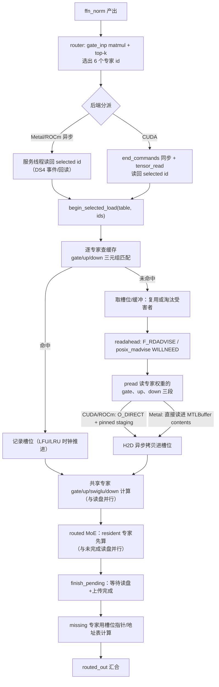

# DS4（DwarfStar）decode 阶段稀疏专家从 SSD 读出的完整链路

> 分析对象：本地 DwarfStar `ds4` 源码树（`~/ds4-new` 工作副本，2026-11-06 观察）
> 关联上游：`antirez/ds4` main `b3f50180`（2026-11-03）。其中 `ds4_metal.m`、`ds4_cuda.cu`、`ds4_ssd.c`、`ds4_gpu.h`、`rocm/ds4_rocm_runtime.cuh` 与该 revision 字节一致；`ds4.c` 是本地工作副本（含本地改动，分析期间还在被并发编辑），因此不对它做上游字节比对。
> 分析日期：2026-11-06 ｜ 性质：只读源码走查 + 独立单元测试，未做真机 decode 计时
> 行号说明：本文行号取自 2026-11-06 的本地 `~/ds4-new` 工作副本；若上游或本地继续改动，行号可能漂移，函数名与调用关系比行号更稳定。
> 机器可读元数据：[metadata.json](metadata.json)

## 一句话结论

DS4 的 SSD 流式推理**不会在 decode 阶段把路由专家（routed experts）留在 mmap 里按页缺页读取**。decode 每个 token、每一层只保留一个**固定大小的槽位缓存（expert cache slots）**：路由器选出 top-k 专家后把 id 读回主机，命中槽位就直接算，未命中的专家才用 `pread()` 从 GGUF 文件按「专家」粒度读进预先对齐的暂存/槽位缓冲，再异步上传到加速器；随后 MoE kernel 通过**槽位指针 / 地址表**消费这些缓冲。整个读取与「共享专家计算」和「已在槽位里的专家计算」重叠，读盘延迟被藏在这段计算后面。

## 1. 背景与前提

DwarfStar `ds4` 是一个 DeepSeek V4 专用 C 推理引擎，Metal / CUDA / ROCm 三套后端。当模型权重放不进显存/内存时用 `--ssd-streaming`：

- 非专家权重（attention、norm、shared expert、router、embedding、output head）走 **mmap**，由 `ds4_gpu_set_model_map_spans` 注册为可访问 span。
- **路由专家权重不 mmap**：对量化一致的层，`model_map_span_vec_include_layer_decode`（`ds4.c:8524`）只在「该层专家与非专家同尺寸类不一致」或 GLM 特殊情形下才把 `ffn_*_exps` 加进 span。也就是说，Uniform 量化的 DeepSeek V4.1 Flash（IQ2_XXS/Q2_K）在 decode 时，专家张量**不在映射范围内**，只能经过专家缓存取得。
- 缓存的字节预算由 `--ssd-streaming-cache-experts N|NGB` 或自动规划给出；缓存放不下全部专家，所以「哪些专家在、哪些要读盘」由路由结果动态决定。

量化规模参考（对本地 `DeepSeek-V4.1-Flash-1017-IQ2_XXS-Q2_K-imatrix.gguf` 直接解析 GGUF 张量表得到）：

| 项 | 值 |
| --- | --- |
| 路由层数 / 每层专家数 | 40 / 384 |
| 单专家 gate+up (`IQ2_XXS`, 5120×2304) | 2 × 3,041,280 B |
| 单专家 down (`Q2_K`, 2304×5120) | 3,870,720 B |
| 单专家合计 | **9,953,280 B ≈ 9.49 MiB** |
| 全部路由专家合计 | **142.38 GiB** |

因此 decode 最坏情况下一个 token 的专家读盘量是 `6 × 9.49 MiB × 40 层 ≈ 2.2 GiB`（每个所选专家都未命中时）；缓存命中率直接决定 decode 速度。

## 2. decode 与 prefill 的区别

| | prefill（多 token） | decode（单 token） |
| --- | --- | --- |
| 每层所选专家 | 每 token top-k，去重后可能上百个 | 每 token 只有 top-k（V4.1 Flash 为 6） |
| 读盘顺序 | CUDA 默认按文件偏移排序并合并相邻读，减少随机 | **默认保持路由顺序**，不排序（`ds4.c:23429` 调 `begin_selected_load` 时 `order_reads=false`；`DS4_CUDA_SSD_SORT_SELECTED_READS=1` 才排） |
| 主要瓶颈 | 层间流水 + 大块顺序读 | 随机小读 + 延迟隐藏 |
| 预取 | 下一层整层 / 批量地址表；文档记录 CUDA 预填默认改为文件序合并读 | 单 token 的 selected load；Metal 侧用异步 early-load |

（prefill 侧的 CUDA 读序演进见 `docs/SSD_STREAMING.md`「CUDA expert reads」一节与上游 commit `b3f50180`。）

## 3. 端到端流水线（decode 单层）

关键点：**「读盘」不是一个阻塞步骤，而是插在共享专家与已驻留专家计算之间的一段异步 I/O**。

## 4. 三个核心数据结构

1. **专家表 `ds4_gpu_stream_expert_table`**（`ds4_gpu.h:466`，构造于 `ds4.c:5330`）
   描述某层路由专家的文件位置：`model_map`、`gate_offset`、`up_offset`、`down_offset`、`gate_expert_bytes`、`down_expert_bytes`、`n_total_expert`。所有后端 API 都以它为输入。

2. **槽位缓存条目**
   - Metal：`g_stream_expert_cache[layer][expert]`（`ds4_metal.m:1057`），保存 `gate_buffer/up_buffer/down_buffer`、inner offset、`last_used`、`use_count`、slab 归属。
   - CUDA：`g_stream_expert_slots`（`ds4_cuda.cu:187`）+ `g_stream_expert_by_gate` 哈希；每个槽位持有 gate/up/down 设备缓冲。
   - ROCm：`g_stream_resident_experts`（`rocm/ds4_rocm_runtime.cuh:303`），按 `(model_map,layer,expert,offsets,sizes)` 建索引。

3. **selected override（`ds4_gpu_routed_moe_set_selected_override`）**
   主机读回专家 id 后写进全局 override，MoE kernel 用它与槽位映射表对齐，保证「加载的专家」和「正在算的专家」是同一组。

## 5. 缓存查找与容量

- **查什么**：以 `(model_map, layer, expert, gate/up/down 绝对偏移, 专家字节数)` 为键。命中即把 `last_used` 提到当前时钟；未命中才走读盘。（Metal `ds4_metal.m:17117` 起；ROCm `cuda_stream_resident_find`，`ds4_rocm_runtime.cuh:1430`；CUDA `ds4_cuda.cu:29108` 起。）
- **容量**：`--ssd-streaming-cache-experts NGB` 先换算成专家个数 `ds4_ssd_cache_experts_for_byte_budget = bytes / per_expert_bytes`（`ds4_ssd.c:72`，`ds4.c:5303`）；纯数字则直接是槽位数。自动规划 `ds4_ssd_auto_cache_plan`（`ds4_ssd.c:108`）按「推荐工作集 × 百分比（默认 80%，`DS4_SSD_AUTO_CACHE_PCT` 可调 50–95） − 非路由权重 − 预填预留」得到预算。预算可能被下调，实际值以启动报告为准。
- **槽位分配**：Metal 支持 slab 分配（同尺寸类专家共用大块，`ds4_gpu_stream_expert_slab_*`）；尺寸不同的混合精度层退回独立分配。ROCm 用约 1 GiB 的 slab 向预算内生长（`cuda_stream_expert_slab_grow`，`ds4_rocm_runtime.cuh:1582`）并保留 `DS4_ROCM_STREAM_FREE_RESERVE_GB`（默认 16 GiB）空闲水位。

## 6. 未命中时真正的「从盘读出」路径（按后端）

### Metal（`ds4_metal.m`）

- `ds4_gpu_stream_expert_cache_begin_selected_load`（`:17012`）在预算为 0 或 `DS4_METAL_DISABLE_STREAMING_EXPERT_EARLY_LOAD` 时直接返回；否则为每个未命中专家准备缓冲，并**启动后台 pread 线程池**。
- 读由 `ds4_gpu_stream_expert_pread_into`（`:13781`）执行：对 gate、up、down 三段分别 `pread(g_model_fd, dst, len, offset)`，`dst` 就是 **`MTLBuffer` 的 `contents` 指针**（shared storage；在 Apple Silicon 上是统一内存，GPU 直接可见，因此没有单独的 H2D 拷贝）。
- 线程池默认 9 线程（`DS4_METAL_STREAMING_EXPERT_PREAD_THREADS`，上限 18），任务表按段展开，`pthread` 池复用（`:13960` 起）。
- 装填 `ds4_gpu_stream_expert_pending_load_install`（`:16874`）把读好的缓冲登记为缓存条目；同一个 token 内选中重复专家时只读一次、共享入口（`source_slots`）。
- 另有 `F_RDADVISE` 预读（`:13641`）与淘汰时的 `POSIX_MADV_DONTNEED`（`:14617`）来降低页缓存压力。

### CUDA（`ds4_cuda.cu`）

- `cuda_stream_selected_cache_begin_load`（`:29015`）先 `cudaStreamSynchronize(cuda_decode_stream())` 确保上一 token 复用安全，然后逐专家分配/回收槽位。
- 读走 `cuda_model_copy_to_device_streamed`（`:2367`）：默认 `O_DIRECT` 打开设备对齐的 fd，使用 `cudaMallocHost` 的 pinned staging 环（4 个 64 MB 缓冲，`cuda_model_copy_chunk_bytes`，`:2149`），`pread` → `cudaMemcpyAsync` H2D → event 记录背压。O_DIRECT 失败（EINVAL/ENOTSUP 等）自动退回普通 fd。
- 未排序模式下每个专家三段读、异步提交；排序模式（`DS4_CUDA_SSD_SORT_SELECTED_READS=1` 或 prefill）按文件偏移合并相邻同段读（`:29199` 起）。
- 预填阶段还支持「下一层整层预取」开关 `DS4_CUDA_ENABLE_SSD_PREFETCH`（`ds4_gpu_stream_expert_cache_prefetch`，`:29408`），decode 默认关闭。

### ROCm（`rocm/ds4_rocm_runtime.cuh`）

- `cuda_stream_selected_load`（`:4054`）逐专家查缓存；未命中则 `cuda_stream_resident_alloc`（`:1653`）取槽位（可能触发 `cuda_stream_resident_evict_one`，`:1489`），并把 gate/up/down 组织成 `read_job`。
- 读由后台读池执行（`cuda_stream_read_worker`，`:2028`）：`cuda_stream_read_job_run`（`:1952`）同样优先 O_DIRECT（`DS4_ROCM_STREAM_NO_DIRECT` 可关），失败回退缓冲读；随后 `cuda_stream_read_job_upload` 在每 worker 自己的 stream 上做 H2D。
- worker 数默认 16、上限 `8×3=24`（`DS4_ROCM_STREAM_READ_WORKERS`，`:2089`）。读先异步启动，MoE kernel 先算已驻留专家，`cuda_stream_selected_finish_pending_missing`（`:4475`）再等待读+上传完成后算缺失专家——这就是 ROCm decode 的延迟隐藏点（调用点 `rocm/ds4_rocm_moe_launch.cuh:1310`）。

## 7. 延迟隐藏（decode 特有的三个手段）

1. **异步 early-load / 后台读池**：Metal 有一个专用服务线程（`metal_graph_selected_async_load_worker_main`，`ds4.c` 内），GPU 上算 router 的同时主机就能拿到 selected id 并开始读。若服务线程不能安全等待在途条目，`ids_ok` 语义让主线程用同一组 id 同步重试（`ds4.c:27080` 附近）。
2. **resident/missing 拆分**：命中与未命中专家分开计算，命中部分先跑，读盘被盖住。Metal 侧要求 miss 数 ≥3 且缓存已有一定规模才拆（`ds4_gpu_stream_expert_split_worthwhile`，`ds4_metal.m:13520`）；ROCm 单 token 走 `cuda_stream_selected_apply`（`ds4_rocm_moe_launch.cuh:702`）的 resident/missing mask。
3. **读前提示**：`F_RDADVISE` / `posix_madvise(POSIX_MADV_WILLNEED)` / CUDA 整层预取，尽量把随机读提前。

## 8. 淘汰策略

- **Metal**：按层内 **路由热度（LFU 近似）+ 最近使用** 淘汰（`ds4_gpu_stream_expert_cache_prune_layer`，`:15722`），热度随 decode token 指数衰减（每 16 token 右移一位，`DS4_METAL_STREAM_EXPERT_HOTNESS_DECAY_TOKENS=16`，`:1008`、`:14697`），并有跨层全局淘汰（`:16485`）。热度统计只看路由选择，避免「反复被选但总被换出」的误判。
- **ROCm / CUDA**：按 `last_used` 时钟做 LRU（ROCm 还优先淘汰「过去层」的条目；CUDA `ds4_cuda.cu:29150` 选 `used` 最小者）。CUDA 的预取条目发布时 `used=1`，只有真正被路由命中才提升，避免无用的预读挤掉热点。

## 9. 计算如何消费缓存（读出来之后）

- **Metal**：每个槽位的 `MTLBuffer` 指针被写进每层的地址缓冲（`g_stream_expert_cache_gate/up/down_addr_buffers`），MoE kernel 通过「槽位地址表」间接取权重；淘汰时把对应地址槽清零（`ds4_gpu_stream_expert_cache_zero_addr_slot`）。这就是保持 `metal/moe.metal` 这类 kernel 不需要知道「权重在盘上还是在缓存里」的关键。
- **CUDA / ROCm**：加载完成后生成 selected-id → 槽位的重映射张量（`slot_selected_ptr`）与 gate/up/down 槽位指针数组；kernel 用 `slot_selected` 与指针数组间接寻址（`cuda_stream_selected_prepare_ptrs`，`ds4_rocm_runtime.cuh:3030`）。若没有映射，kernel 会明确报「full expert table is not mapped」而不是静默出错。

## 10. 常用开关（decode 相关）

| 开关 | 作用 |
| --- | --- |
| `--ssd-streaming` | 启用流式 |
| `--ssd-streaming-cache-experts N\|NGB` | 槽位预算（专家数或 GiB） |
| `--ssd-streaming-cold` | 跳过默认热门专家预填 |
| `--ssd-streaming-preload-experts N` | 启动时预填专家数 |
| `DS4_SSD_AUTO_CACHE_PCT` | 自动缓存百分比（50–95，默认 80） |
| `DS4_METAL_DISABLE_STREAMING_EXPERT_EARLY_LOAD` | 关 Metal 异步 early-load |
| `DS4_METAL_STREAMING_EXPERT_PREAD_THREADS` / `..._PREAD_POOL` | Metal 读线程数与线程池 |
| `DS4_CUDA_SSD_SORT_SELECTED_READS` / `DS4_CUDA_DISABLE_SSD_SORT_SELECTED_READS` | CUDA 单 token 读序（默认不排序） |
| `DS4_CUDA_ENABLE_SSD_PREFETCH` / `DS4_CUDA_DISABLE_SSD_PREFETCH` | CUDA 下一层整层预取 |
| `DS4_ROCM_STREAM_READ_WORKERS` / `DS4_ROCM_STREAM_NO_DIRECT` / `DS4_ROCM_STREAM_FREE_RESERVE_GB` | ROCm 读池、禁用 O_DIRECT、空闲预留 |
| `DS4_METAL_STREAMING_EXPERT_TIMING_SUMMARY`、`DS4_ROCM_STREAM_CACHE_STATS`、`DS4_ROCM_STREAM_READ_PROFILE` | 读写/命中/延迟统计 |

## 11. 本次分析的验证程度与限制

已做：

- 逐函数走查三套后端（Metal / CUDA / ROCm）与公共层的 decode 路径，覆盖 `pread` 调用点、缓存键、槽位分配、淘汰、消费四段。
- 直接解析目标 GGUF 的张量表，核对单专家字节数与总规模（见 §1 表格）。
- 运行仓库自带的独立单元测试 `make test-ssd-cache` → `SSD cache sizing: PASS`（验证 `ds4_ssd_auto_cache_plan` / `ds4_ssd_cache_experts_for_byte_budget` 的预算计算）。

未做（诚实标注）：

- **没有真机 decode 计时/命中率数据**。本机已有另一个 `ds4` 进程持有实例锁（`ds4: another ds4 process is already running`），因此没有强制起第二个进程跑 live decode，避免打扰在用推理。
- 未在本机复现 Metal 路径（本机是 AMD Strix Halo / ROCm）。
- 行号为 `~/ds4-new` 工作副本（2026-11-06 快照）；上游 `antirez/ds4` main `b3f50180` 的 `ds4.c` 与本地不完全字节一致，若上游后续改动，行号可能漂移。

## 12. 源码索引（本地工作副本行号）

| 位置 | 内容 |
| --- | --- |
| `ds4_ssd.c:72` / `:108` | 字节预算 → 专家数 / 自动缓存规划 |
| `ds4.c:5194` | 单专家字节数（取本地最常见尺寸类） |
| `ds4.c:5330` | `graph_stream_expert_table_make` |
| `ds4.c:8524` | decode 时哪些专家张量才进 mmap span |
| `ds4.c:21853` | `metal_graph_stream_map_layer_decode` |
| `ds4.c:23226` / `:23406` / `:23469` / `:23667` | 四处 `begin_selected_load` 调用（hash override / readahead / CUDA selected / async worker） |
| `ds4.c:26825`–`26900` | decode 的 overlap/async/CUDA load 决策 |
| `ds4.c:27081` / `:27109` | 同步兜底加载与 override |
| `ds4_metal.m:1000`–`1008` | 缓存上限、热度衰减常量 |
| `ds4_metal.m:13482` / `:15722` / `:16485` | 有效容量 / 层内淘汰 / 全局淘汰 |
| `ds4_metal.m:13641` / `:13781` / `:13960` / `:14617` | F_RDADVISE / pread / 线程池 / DONTNEED |
| `ds4_metal.m:16323` / `:16874` / `:17012` | 缓冲准备 / 装填 / early-load 入口 |
| `ds4_cuda.cu:2149` / `:2367` / `:29015` / `:29408` | 拷贝块 / O_DIRECT+H2D / 单 token 加载 / 整层预取 |
| `rocm/ds4_rocm_runtime.cuh:1489` / `:1582` / `:1653` / `:1952` / `:2089` / `:4054` / `:4475` | 淘汰 / slab / 槽位 / 读任务 / 读池 / 单 token 加载 / 等待缺失 |
| `rocm/ds4_rocm_moe_launch.cuh:702` / `:1310` | 单 token apply / 缺失专家等待点 |
