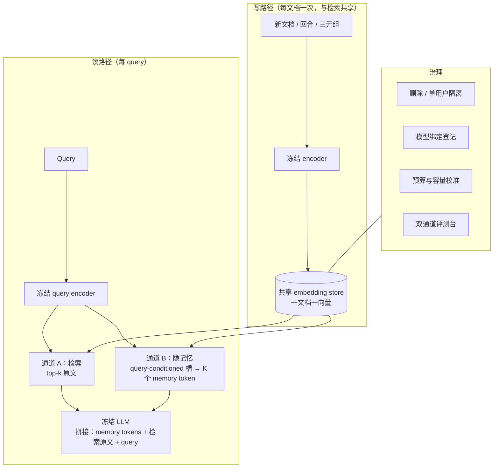

# 02 · 对后续 memory 系统设计的建议

> 本页把 [01](01-article-analysis.md) 中的原文事实转成**可施工的设计建议**。
> 每条建议标注依据强度：**[A]** 原文有直接实验支撑；**[A-代码]** 官方仓库/配置/模型卡中的可核实事实；**[B]** 由多条证据推出的合理设计；**[C]** 本文推断，需自行实验验证。
> 原文未给出的信息（置信区间、成本模型、错误传播分析等）在 [03](03-claims-and-evidence.md) 中单列，本页不把单案例数字当效应量使用。

## 0. 一页设计立场

如果只能记住六句话：

1. **隐记忆与 RAG 是两条不同通道，不是同一功能的两种实现。** 一个吃**关系与聚合**，一个吃**字面与精确**；它们的**错题集合几乎不重叠**（FactKG oracle union 94.3% vs 各自 84.3%/78.4%）[A]。
2. **记忆的预算要与任务的"跨文档整合度"匹配。** 需要跨 100+ 文档聚合的个性化任务从 16 个槽的**最后几个**里拿到主要增益；只需要读一个短摘要的任务（PubMedQA）压缩**根本是负收益** [A]。
3. **写入路径必须与既有的稠密检索索引共享。** 复用同一套 embedding，则"增加一篇文档"的成本 = 一次 encoder pass，与建检索索引**同价** [A/A-代码]；不共享就等于把存储成本翻倍 [B]。
4. **读路径的收益来自"平坦"，不是"更快"。** 单次 query 延迟由 decoding 主导；隐记忆的价值是 read 成本不随集合增长（N=1→512 端到端 740→739 ms）并摊薄到 Q 个 query [A]。
5. **隐记忆把系统绑定到具体模型。** 记忆写在 LLM **输入 embedding 空间**，所以需要开放权重、且**每个 LLM 一个记忆模块** [A]。这是架构决策，不是实现细节。
6. **凡是"写入用户数据"的记忆，删除能力必须在第一页设计。** store 在模型外所以可不重训删除，但**embedding 本身仍可能编码敏感信息** [A]。

## 1. 十条设计不变量

| # | 不变量 | 依据 | 违反后果 |
| --- | --- | --- | --- |
| **I1** | **双通道**：隐记忆负责跨文档聚合，检索负责精确字面与溯源；默认**同时**建设 | [A] FactKG：15.9% 仅 MEMORILLA 对 / 10.0% 仅 RAG-50 对；8 个 benchmark 的 union 均高于任一方法 | 只做一条通道，等于放弃另一条的错题；单通道的"上限"其实是双通道的"下界" |
| **I2** | **query-conditioned 优先于 query-independent 压缩** | [A] mean-pool 31.10 vs 44.04（参数匹配）；query-independent 加参数救不回来 | 用一套固定摘要服务所有问题，长尾问题系统性失败 |
| **I3** | **先条件化、后读取**（condition-then-read），而不是"先读再融合" | [A] 把文档换成高斯噪声时 documents-only 只变 +0.04，而 MEMORILLA 掉 5.93 | 记忆"看起来在工作"，实际没依赖真实证据 |
| **I4** | **固定 token 预算 + 硬上限**，与集合规模解耦 | [A] K=16 全程；K=128 训练无增益；推理时收益集中在最后几个槽 | 上下文随数据增长；预算失控 |
| **I5** | **写路径与稠密检索共享 embedding / 索引** | [A/A-代码] 官方明确"encoding adds no cost over retrieval" | 双份编码与双份存储成本 |
| **I6** | **容量按任务校准**：跨文档整合强的任务给更多槽，短源任务退回原文 | [A] PMv2/PV4 靠最后几个槽；PubMedQA 压缩为负收益（59.00 vs 69.00） | 在不该压缩的任务上压缩，白付成本还掉分 |
| **I7** | **把"全上下文"当作 baseline、不是上界** | [A] Table 11 的 21 个指标里全上下文 20 个落后；RAG-50 又在 15 个上超过全上下文 | 用"塞满上下文"当兜底，实际经常更差且更贵 |
| **I8** | **显式记录"模型绑定"与迁移代价** | [A] 记忆写入 LLM 输入 embedding 空间 ⇒ 需要开放权重、每个 LLM 一套；跨模型族未测 | 换模型 = 重训记忆，且历史 store 可能不可迁移 |
| **I9** | **隐私：可删除 + 最小化 + 单用户隔离** | [A] store 在模型外可删；但 embedding 仍可能编码敏感信息；PV4 每用户一个 store | 无法响应删除请求；跨用户泄漏 |
| **I10** | **评测必须分开报"机制增益"与"信息增益"** | [A] TextWorld 用同预算 + 全历史对照，才能把 0.186→0.242 归因给"学到了什么" | 把"多给 token"误认成"记忆机制有效" |

## 2. 参考架构：双通道记忆

**两条通道的分工（按原文证据）：**

| 通道 | 擅长 | 证据 | 成本形态 |
| --- | --- | --- | --- |
| 隐记忆 | 跨文档聚合、"why/how" 因果与关系、多实体推理 | [A] NarrativeQA why +4.91 / how +7.02；FactKG 实体数越多优势越大（+4.23pp → +7.59pp）；组合事实下 RAG 78.7→51.8 而它稳在 80–89 | read 平坦（16 token 恒定） |
| 检索 | "who/which" 类逐字实体、精确名字、可溯源原文 | [A] NarrativeQA who −3.45 / which −2.93；MemoRAG 靠逐字段落拿下 NarrativeQA ROUGE | prefill 随 top-k 增长 |

**落地顺序建议（[B]，理由来自 [A]）：** 先建**检索**通道（成熟、可溯源、无需训练）；隐记忆应作为**第二通道**加入，并用**逐题分解**证明其边际价值。理由是 RAG-50 单通道已经能拿到"任一方法答对"中的大部分（FactKG 78.4/94.3 ≈ 83%、PubMedQA 67.0/80.0 ≈ 84%、TriviaQA 55.6/74.2 ≈ 75%），而 MEMORILLA 的独占贡献各 benchmark 不同（FactKG 15.9%、PMv2 27.1%），只有逐题分析才能确定它在具体任务上是不是值得引入。

## 3. 何时该用隐记忆，何时不该

**决策树（[B]，全部判据来自 [A]）：**

1. **源短且能整体放进上下文？**（如 PubMedQA 324 token）→ **不要压缩**，直接读原文。压缩在短源上是负收益（-8 到 -10 个点）。
2. **答案依赖"逐字出现"的实体 / 数字 / 代码？**→ **必须保留检索通道**；纯隐记忆会丢精确表面形式（NarrativeQA who/which 落后）。
3. **答案依赖跨很多文档的关系与聚合？**（个性化、多跳验证、跨书推理）→ **隐记忆的主战场**（FactKG 84.33 vs 80.43；PMv2 44.60 vs 最强 baseline 30.90）。
4. **集合随时间增长、query 很多？**→ 隐记忆的 read 平坦特性才真正兑现价值；单次 query 场景收益有限（延迟被 decoding 主导）。
5. **需要 open weights 吗？**→ 若只能调 API、拿不到输入 embedding，**这条路线直接不可用** [A]。

## 4. 容量与预算规划

**建议做法（[B]，锚点来自 [A]）：**

| 决策 | 建议 | 锚点 |
| --- | --- | --- |
| 初始预算 | 从 **16** 个槽起步 | [A] K=16 是全文默认；K=128 从头训练 4/8 个 benchmark 变化 <1 点，PMv2/PV4 反而下降 |
| 是否加大 K | **先做推理时预算曲线**（用已训 checkpoint 取前 K 个槽），找到任务的"拐点" | [A] Figure 10：PMv2 在 K=4 前贴 closed-book，K=16 冲到 44.60；FactKG/TriviaQA/NQA 每次减半都掉 |
| 短源任务 | **不做隐记忆**，直接原文 | [A] PubMedQA 59.00 vs 67.00/69.00 |
| 槽的初始化 | 默认可学习共享向量；**关系型/结构化任务**可考虑 retrieval-init | [A-代码] `configs/factkg.yaml` 用 `retrieval_init: true`，槽从最相似三元组初始化 |
| 架构 | 默认"query conditioning + cross-attn 读取"；Q-Former 式变体是可接受的近似 | [A] Q-Former 43.34 vs MEMORILLA 44.04（PMv2），但 FactKG 上 80.48 vs 82.56 且参数更多 |

**预算不等于容量：** 原文 Figure 10 明确，从 16 槽 checkpoint 上取前 K 个**不是**"训练 K 个"的等价物——两者结论必须分开报 [A]。设计评测时要**同时**跑"训练容量曲线"与"推理预算曲线"。

## 5. 写入与训练路径

**写路径（[A]/[A-代码]）：**

- 文档编码一次、持久化、后续 query 复用；新增文档只编码新增部分。
- 单文档存储约 **5 KB**（2,560 维 bf16 embedding），**与集合大小无关**；PV4 上 store 比对应 KV cache 小 **7,266×**。
- 写路径成本**线性于 N**（N=1: 22.92 ms → N=512: 2,588.84 ms），且与稠密检索索引**共享**，不是新增成本。

**训练路径（[A]）：**

- **三段式课程**：通用内容保真（EnWiki 复述）→ 多任务混合（阅读理解/QA/摘要）→ 下游混合。这个顺序有明确理由：先把"保住信息"训好，再学"针对不同任务召回不同信息"，最后才贴近评测分布。
- **只训记忆模块**（约 1.94 亿参数），encoder 与 decoder 全程冻结。冻结的收益：store 可移植、decoder 不动；代价：**encoder 从未为压缩而优化**——原文把它列为细粒度信息丢失的**可能原因**，并把"训练专用压缩 encoder"列为最近的后续步骤。
- **过拟合管理**：8 个 benchmark 共享一个多任务 checkpoint；对收敛慢的（PV4/PMv2）才额外微调；按 validation loss 选 epoch。
- **训练成本画像（[A-代码]）：** 4×H100 下 Stage 1≈6h、Stage 2≈4h、Stage 3≈9h、单任务微调≈25min；数据约 320 GiB（几乎全是 embeddings）。

**RL 路径（agent 场景，[A]）：**

- 只训记忆模块、**不加载监督 checkpoint**、用环境奖励 GRPO（G=16、PPO clip 0.2、无 critic/KL/entropy）即可让冻结 agent 提升（avg@3 0.186→0.242）。
- **RL 场景的记忆是"补充"而非"替代"历史文本**：原文在所有条件里保留完整历史、同预算对照，才把增益归因于记忆学到了什么。设计 agent 记忆时应沿用这个对照范式。
- **未训练记忆会低于 baseline**（0.153 < 0.186）——即"多几个 token"本身**有害**，务必不要把它当作免费噪声预算。

## 6. 评测设计（本页最重要的一节）

原文的评测台有四个值得直接抄的设计：

1. **共享一切可共享的东西。** 所有 baseline 用**同一个冻结 decoder、同一个冻结 encoder、同一批 chunk**；Mem0/MemoRAG 额外用同规模的 4B 模型处理文档。只有这样才能把差异归因给"记忆机制"。[A]
2. **逐题分解，而不只看总分。** 按题型（why/how/who/which）、按实体数、按组合事实数拆开；互补性用"各自独占答对的比例"和 oracle union 表达。[A]
3. **报告压缩倍数时带上口径。** 原文把"文档 token"定义为**排除问题、答案格式、系统提示、chat 模板**之后的部分，并按 Qwen3 tokenizer 计数、按评测问题求均值；压缩列 = Full Context token ÷ 16。[A]
4. **区分"训练容量"与"推理预算"。** 见 §4。

**建议补充（[C]，原文未做）：**
- 报**置信区间 / 显著性**（原文多为单点比较；同一系统上 BLEU/ROUGE 的细微差异通常不显著）；
- 报**成本**（美元 / GPU 秒 / 每 query 的 prefill token），而不仅是 token 数；
- 做**跨模型族迁移**实验（原文明确未做）；
- 单独测**"记忆里有没有幻觉"**——即隐 token 是否会被下游 LLM 当成事实而不加验证（原文未涉及此类风险分析）。

## 7. 反模式清单

| 反模式 | 为什么错 | 证据 |
| --- | --- | --- |
| 用**单个隐 token** 做全部记忆 | 信息瓶颈过窄；xRAG 单 token 路线平均 41.92，明显低于 16 槽的 49.68 | [A] Table 11 |
| 用 **query-independent 摘要** 服务所有问题 | 加参数也无法弥补（参数匹配后 31.10 vs 44.04） | [A] Table 13 |
| 把 **compaction 当 memory** | compaction 目的是让当前会话继续，不积累跨 session 知识 | [B]（与 Anthropic 的界定一致，见仓库既有调研） |
| 认为**全上下文是上界** | 21 个指标里 20 个落后；把全部集合塞进去经常更差 | [A] Table 11 |
| 在**短源**上也上压缩 | PubMedQA 上 -8 ~ -10 个点 | [A] Table 11 |
| 只做隐记忆、不留**原文通道** | 丢掉精确名字 / 逐字证据 / 可溯源能力；who/which 类系统失败 | [A] Figure 4a |
| 用**未训练**的记忆模块当 baseline 之上加噪声 | 可能比不加更低（0.153 vs 0.186） | [A] Figure 8 |
| 在**闭源 API** 上规划这条路线 | 需要写 LLM 输入 embedding ⇒ 需要开放权重、每模型一套 | [A] Limitations |
| 把 PV4 当作**真实用户数据**代表 | 它是合成 persona（GPT-5/5.1/5-mini 生成）、**同一机器模板**、与训练用户不相交 | [A] Ethics + [A-代码] 数据卡 |

## 8. 隐私、治理与部署

- **删除：** store 在 LLM 外部 ⇒ 用户 embedding 可**不重训**直接删除 [A]。
- **但 embedding 仍可能编码敏感信息** [A]；存储/传输需加密与访问控制，且**部署应取得用户同意**。
- **单用户隔离：** 主页 Outlook 明确设想"每个用户独立 store、可留在设备上、可按要求删除"；PV4/Mem0 的实现也按用户分 store（Mem0：一用户一 Qdrant collection）[A]。注意 MEMORILLA 本身的论文实验**没有**把"每用户独立 store"作为架构约束——这是产品层的推断方向 [C]。
- **多模态扩展：** store 只存 embedding ⇒ 理论上同一接口可扩展到图像/音频/视频 [A]；但原文明确**未测** [A]。
- **一个 store 服务多模型：** 原文列为未来方向 [A]；主页的 "Memory beyond one model" 也提到"可移植记忆模块让一个 store 服务多个模型" [A]。
- **开放权重前提：** 若部署形态是闭源 API，这条路线需要先解决"如何注入 embedding"的问题（[C] 原文未提，属工程约束）。

## 9. 分阶段落地路线图（[B]/[C]）

| 阶段 | 目标 | 产物 |
| --- | --- | --- |
| **P0 · 基线台** | 建双通道评测台：闭卷 / RAG-$k$ / 全上下文 / 逐题分解 / oracle union | 一张能区分"机制增益 vs 信息增益"的对照表；先证明检索通道的价值 |
| **P1 · 共享写路径** | 统一 embedding store，写路径与检索索引复用；加删除与单用户隔离 | 可增长、可删除的 store；成本曲线（写线性、读平坦） |
| **P2 · 隐记忆 v1** | query-conditioned 槽 + cross-attn 读取，K=16，三段式课程 | 在**跨文档聚合**类任务上验证边际增益；同时报推理预算曲线 |
| **P3 · 双通道合并** | 在同一 query 上同时给 memory tokens 与检索原文；测混合 vs union 上界 | 混合系统实测值（对比 oracle union，量化"还差多少"） |
| **P4 · 容量与迁移** | 校准 K；测跨模型族迁移；评估压缩专用 encoder | 容量—收益曲线；迁移报告；细粒度细节改进 |
| **P5 · agent 持续学习** | 用环境奖励 RL 只训记忆模块；严格同预算对照 | agent 任务上的 avg@k/pass@k 提升 + 循环减少证据 |

## 10. 与仓库既有调研的衔接

本仓库已有一份 Anthropic《The components of agent memory》精读（`docs/research/agent-memory/`，见 [PR #9](https://github.com/ai-storage-agent/c2k-pilot/pull/9)，截至本文撰写时尚未合并），两份调研在**结论层**高度互补：

| 维度 | Anthropic 调研的立场 | MEMORILLA 的立场 | 合并建议 |
| --- | --- | --- | --- |
| 记忆的载体 | **可读上下文**（文件/目录/笔记），显式排除权重更新与隐向量 | **LLM 输入 embedding 空间的隐 token** | 二者可并存：显式笔记管"规则/计划/陷阱"，隐 token 管"跨文档聚合"；[C] |
| 谁决定记什么 | 模型自己判断 salience | 用**答案监督或环境奖励**训练一个小模块 | 显式层用模型判断，隐层用任务信号训练；[C] |
| 整理方式 | 离线 dreaming（纠错/建表示/升级层级/补缺口），必须对照 transcript | 训练期课程 + 推理时无整理（query 直接读全 store） | 隐记忆缺少"纠错"环节；显式层仍是唯一可审计的纠错通道；[C] |
| 注入层风险 | **注入层是风险最高处**：错误会被带进每个未来 session | 16 个 token 是黑箱，**无法逐条审计或删除单条记忆** | 隐记忆只放"可重算/低风险"的聚合信号，不放需逐条治理的事实；[C] |
| 可溯源 | 每条记忆可溯源到原始证据 | 隐 token **不保留 provenance** | 需要溯源的场景强制走检索通道；[A/B] |

**一句话合并（[C]）：** 后续系统应把显式、可审计、可版本化的记忆（Anthropic 路线）作为**治理平面**，把隐记忆（MEMORILLA 路线）作为**性能平面**的一个查询相关通道；二者共享同一套 embedding 存储与同一条评测台，且隐通道必须先通过与检索通道的**逐题互补性**检验，才值得引入。
