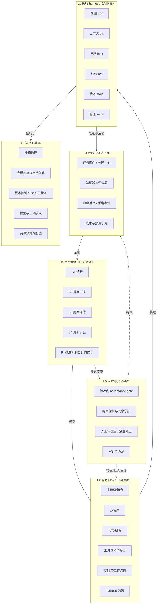

# 04 · RSI Agent Harness 参考架构

> 本页是整个调研的核心交付物：把前沿 RSI/自演化 agent 研究中的机制抽象成一套可实现的参考架构。
> 事实基础见 [01](01-landscape.md)–[03](03-harness-anatomy.md) 与 [references.md](references.md)；工程对照见 [07](07-implementation-landscape.md)。

## 1. 设计立场与三条不变量

参考架构不是某一篇论文的重述，而是从多个独立工作中收敛出的共同结构。它建立在三条不变量上：

**不变量 1：把 harness 当成一等可修改对象。** 现代 agent 的能力 = 基础模型 × 执行 harness。[2606.20683](references.md#ref-2606-20683) 把 harness 分解为观测、上下文、控制、动作、状态、验证六项运行时职责，并论证 harness 设计是独立于模型规模的性能杠杆（SWE-agent 在固定模型下仅靠 ACI 重设计就大幅提升）。RSI 的第一性前提是：这些职责的实现必须可版本化、可寻址、可替换。

**不变量 2：把"改进"分解为可持续的更新循环，而不是一次性优化。** [2610.35193](references.md#ref-2610-35193) 给出的 RSI 定义要求系统不仅更新策略，还能修订并复用"未来更新的机制"本身：

- `h`（policy）：任务策略；在 LLM 系统里 = 模型 + 提示词 + 记忆 + 技能 + 工具；
- `B`（inductive bias）：如何学习/修订策略的偏好——数据选择规则、目标函数、假设空间、优化过程；
- `U`（bias update function）：修订 `B` 的机制，本身可被修订为 `U_{t+1}` 并在后续循环复用。

判定一段自动化是否属于 RSI，标准是它是否触及 `B` 与 `U`，而不只是 `h`。一个"把 prompt 调得更好"的循环只是 `h` 层面的改进。

**不变量 3：自我修改必须被验证、可回滚、可审计。** [2610.21646](references.md#ref-2610-21646) 证明：在全一般设定下，不存在同时保证**可靠性**（绝不接受非改进）与**非保守性**（绝不漏掉可用改进）的终止性验收门。因此架构不能假设"门是对的"，只能：把验收限制在可判定的有界预算区间、保留人工否决、记录每次决定的证据，并让回滚成为廉价操作。

由这三条不变量直接得到 RSI harness 与普通 agent harness 的差别：普通 harness 的可变面是"任务状态"，RSI harness 的可变面还包括"harness 自身"。

## 2. 总体分层



分层的判据是**变更频率与责任边界**，不是调用顺序：

| 层 | 变更频率 | 谁可以改 | 典型制品 |
| --- | --- | --- | --- |
| L0 运行时基底 | 最低（部署级） | 仅人类运维 | 容器/沙箱镜像、持久化后端、凭据 |
| L1 执行 harness | 低 | 人 + 受治理的自动优化 | 六职责的实现代码与配置 |
| L2 能力制品库 | 高 | 改进引擎在治理下可写 | prompt、skill、memory、tool 定义 |
| L3 改进引擎 | 中 | 受 RI 约束的自动修订 | 诊断/提案/评估/实施流程本身 |
| L4 评估与证据 | 低-中 | 仅人类 + 审计流程 | 任务套件、验证器、阈值 |
| L5 治理与安全 | 最低 | 仅人类 | 验收策略、审批点、回滚策略 |

**关键的架构约束：** L4 与 L5 的写入者必须独立于 L3。如果改进引擎能改写自己的评分器或验收阈值，那么 [2610.11464](references.md#ref-2610-11464) 的"验证者退化"和 [2610.38392](references.md#ref-2610-38392) 的"遮罩侵蚀"就会系统性地发生。这条约束是整个架构安全性的支点。

## 3. L0：运行时基底

RSI 比普通 agent 对基底的要求更高，因为自修改会产生大量短生命周期的候选版本。

| 能力 | 要求 | 依据 |
| --- | --- | --- |
| **沙箱执行** | 每次候选评估在隔离环境运行；文件系统、网络、凭据按最小权限授予；危险动作默认拒绝 | DGM 明确以 sandboxing + human oversight 为前提；[2606.20683](references.md#ref-2606-20683) 把 sandboxing 列为 harness 的治理职责 |
| **原子会话/检查点** | 在一次模型请求前、一次可能产生外部副作用的顶层工具调用前、下一步开始前落盘；检查点失败 fail-closed | 长周期自改进不能因崩溃丢失或重放副作用 |
| **Git 原生状态** | 全部候选版本、其血缘、评估结果以版本控制对象存储，支持 resume / rewind / fork / compare / merge | [2610.19591](references.md#ref-2610-19591) 把"富状态轨迹而非聊天记录"作为核心设计 |
| **资源配额** | 每个改进循环有显式 token / 工具调用 / 墙钟 / 资金预算；预算耗尽即停止并记录 | RSI Gym 以单基准 $500 预算运行联合改进；[2610.37276](references.md#ref-2610-37276) 讨论评估预算分配 |
| **可重现性** | 固定模型版本、随机种子、工具镜像与数据快照；同一候选可重跑得到可比较结果 | [2610.27610](references.md#ref-2610-27610) 发现只有 22% 的 RSI 研究报告了 ≥2 次完整循环重跑 |

**反模式：** 把候选版本存在临时目录或内存里、用文件名而不是内容哈希做标识、评估环境与部署环境不同源。这些都会让"改进是否真实"无法回答。

## 4. L1：执行 harness 的六项职责

采用 [2606.20683](references.md#ref-2606-20683) 的分解作为规范骨架，因为它是目前对"harness 到底是什么"最完整且被多个独立系统印证的操作化定义。对每项职责，RSI 版本都在普通版本之上增加一个**可修改面**。

### 4.1 观测接口 `I_obs`

把环境信号（终端输出、文件 diff、截图、DOM、API 响应、日志）转换为模型可消费的观测。

- **设计问题：** 哪些状态相关、用什么抽象层次表示、何时刷新。
- **RSI 增量：** 观测构造器本身是候选制品。典型被演化出来的改进正是"更好的代码编辑工具""长上下文窗口管理"（DGM 自述的两项自动改进）。
- **验证要求：** 观测保真度必须与被修改的观测代码一起版本化，否则改进无法归因。

### 4.2 上下文管理器 `C`

决定哪些信息进入当前模型调用，以及以什么形式：选择、压缩、排序、刷新。

- **形式化：** `C = A(c_1,…,c_n)`，`A` 是组装函数；工程目标从"写好提示词"变为"优化检索/选择/压缩/格式化的函数集合"。
- **RSI 增量：** 上下文策略是最高频、最低风险的自我修改目标。但 [2610.25858](references.md#ref-2610-25858) 发现全局编辑共享 prompt 会干扰未见过任务并覆盖旧知识——**稳定性-可塑性权衡**。因此上下文修改应优先局部化（相似度检索、分域记忆）而不是全局重写。
- **验证要求：** 上下文压缩会削弱下游验证能力（跨层耦合），压缩率提升必须与验证召回一起评估。

### 4.3 控制循环 `L`

组织执行：perceive-act、ReAct、plan-execute-verify、层级/多 agent 工作流；决定控制权在模型与运行时之间如何划分、何时委派、何时停止。

- **RSI 增量：** 工作流图是明确的演化对象。ADAS 的 Meta Agent Search、AFlow 都让元 agent 编程出更好的 agent 代码/工作流；[2607.13104](references.md#ref-2607-13104) 将其形式化为对 scaffold 组件的更新算子。
- **验证要求：** 控制流变更最易产生"看似提升、实为过拟合"的结果，必须配合分层 holdout。

### 4.4 动作接口 `I_act`

把模型输出映射为可执行操作：工具粒度、规格（自由命令 vs 结构化 schema）、路由（本地 vs MCP 类协议）、治理（权限、副作用控制）。

- **RSI 增量：** SWE-agent 证明动作接口质量是固定模型下的主要性能来源；DGM 自动演化出的"更好的代码编辑工具"正属于此层。工具也是**安全边界所在**。
- **验证要求：** 新增工具必须同时声明其副作用等级与所需权限；[2610.19591](references.md#ref-2610-19591) 用"效果可逆性"直接推导工具的审查层级。

### 4.5 状态与制品存储 `S`

跨步骤、跨会话、跨子任务持久化执行状态：进度、轨迹、计划、检查点、diff、生成文件、记忆。

- **核心问题不是"存多少"而是"什么值得持久化、什么该压缩、什么该丢弃"。**
- **RSI 增量：** 记忆与技能库从"轨迹保存"演进到"轨迹抽象/经验"（[2605.06716](references.md#ref-2605-06716) 的三阶段：Storage → Reflection → Experience）。
- **验证要求：** 陈旧记忆被当作当前事实是已知失败模式；状态需要可失效、可溯源、可回滚。

### 4.6 验证与治理 `V`

运行时检查、约束与修复：测试、断言、验证器模型、judge 信号；以及审批门、沙箱、预算控制、回滚、重试、升级、安全终止。

- **这是 RSI 与普通 agent 差别最大的一层。** 普通 agent 的验证服务任务完成；RSI 的验证还要服务"是否接受这次自我修改"。
- **RSI 增量：** 验证器本身成为演化对象（[2610.11464](references.md#ref-2610-11464) 的 inspectable grader、[2610.17609](references.md#ref-2610-17609) 的 verifier-harness 共同演化），因此必须增加"验证验证器"的独立机制。

## 5. L2：能力制品库（可变面）

把 L1 的实现细节与可被改进引擎修改的**制品**分开。制品是有名字、有版本、有血缘、有评估记录的持久对象。

| 制品 | 内容 | 变更代价 | 典型验证信号 |
| --- | --- | --- | --- |
| 指令/提示 | 系统提示、角色提示、规则文本 | 低 | 分层任务套件、回归集 |
| 技能 | 可复用过程：代码函数、SKILL.md 包、工作流图、学到的 adapter | 中 | 单元测试、执行成功、复用率 |
| 记忆/经验 | 轨迹、反思、抽象经验、世界模型规则 | 低 | 检索命中、下游提升、漂移审计 |
| 工具/动作 | 工具实现与 schema、动作接口 | 中 | 工具调用成功率、副作用审计 |
| 控制流 | 工作流图、委派/编排拓扑 | 中-高 | 端到端基准、成本 |
| harness 源码 | L1 六职责的实现代码 | 高 | 全量回归 + 人工审查 |

**技能库是最成熟的演化制品范式。** [2607.10113](references.md#ref-2607-10113) 对 124 篇 2023–2026 工作做审计，提出六感（六种结构不同的"技能"）分类与**八阶段生命周期**；[2608.29596](references.md#ref-2608-29596) 提出**九阶段生命周期**：自主发现 → 编写与表示 → 记忆存储 → 动态检索路由 → 组合编排 → 执行与修复 → 终身适应 → 经验评估 → 安全治理。二者独立收敛到几乎相同的阶段序列，因此可以作为技能子系统的规范生命周期。

参考架构采用的技能记录 schema（综合两份综述的字段）：

```text
skill_record {
  id, name, version, content_hash
  representation      # nl_instruction | code | workflow_graph | adapter | SKILL.md
  preconditions       # 可观测的适用条件
  postconditions      # 成功判据
  provenance          # 来源轨迹 id、提案者、时间
  evidence            # 支持性观察/测试结果
  confidence, utility # 动态信号，不是静态统计
  validation_status   # proposed | admitted | rejected | deprecated
  dependencies        # 依赖的其他技能/工具/版本
  side_effect_class   # 只读 | 可逆 | 不可逆
  lineage             # 派生自哪个技能，被哪些任务使用
}
```

**准入与修复比生成更重要。** 多份工作一致发现：技能库的瓶颈不在"能否提出新技能"，而在"能否验证、准入、修复、剪枝"。SELM 用 utility-aware 检索 + 生命周期控制；CDSE 把技能分解为 Meta/Experience/Tool/Script 四个功能组件做差异化更新。

## 6. L3：改进引擎（RSI 循环）

采用 [2610.35193](references.md#ref-2610-35193) 的 S1–S4 + RI 作为规范循环。这一定义的价值在于它明确区分了"改进策略"与"改进改进方式"。

```mermaid
flowchart LR
  E[经验 E_{t+1}] --> S1
  F[反馈 F_{t+1}] --> S1
  S1[S1 诊断\n定位限制、定义改进目标] --> S2
  S2[S2 提案生成\n对 h 或 B 产生候选修订] --> S3
  S3[S3 提案评估\n按验收标准评估、查回归] -->|accept| S4
  S3 -->|reject| LOG[记录拒绝与理由]
  S4[S4 更新实施\n并入 h_{t+1} / B_{t+1}] --> RI{RI\n是否修订 U 本身?}
  RI -->|是| S1
  RI -->|否| N[下一循环]
```

### 6.1 S1 诊断

输入：当前 `h_t`、`B_t`、新经验 `E_{t+1}`、反馈 `F_{t+1}`。
输出：限制定位 + 改进目标（要改 `h`、`B` 还是两者）。

- **架构含义：** 诊断质量决定搜索效率。[2610.30042](references.md#ref-2610-30042) 的 HGM-Dual 发现规划任务中"改进 agent 的能力"与"被改进的能力"不重合，开放式的随机自修改会大量浪费评估预算；因此引入**血缘感知的上下文**（记录每个祖先改了什么、哪些行为改善或退化）和**误差条件下的双路径子代生成**。
- **参考实现：** 诊断应产出结构化的 `{failure_class, evidence, affected_component, proposed_objective}`，而不是自由文本。

### 6.2 S2 提案生成

对 `h_t` 通过学习过程 `A_{B_t}` 产生候选，或对 `B_t` 通过 `U_t` 产生候选。此时修订尚未并入系统。

- **搜索策略是关键设计选择：**
  - **贪心/单链：** 简单，但陷入局部最优、无法回溯；
  - **开放式的档案/种群搜索：** DGM 维护生成 agent 的档案，从中采样并用基础模型生成新版本，形成不断生长的树；在 SWE-bench 上 20.0% → 50.0%，Polyglot 14.2% → 30.7%。
  - **AFlow / ADAS：** 元 agent 在代码空间搜索工作流；ADAS 报告发现的 agent 跨域、跨模型迁移后仍优于手写 agent。
- **架构含义：** 档案不只是缓存，它是**探索机制**。它保留了"踏脚石"——那些当前不最优但能通向更好解的中间版本。丢弃它们会把开放式搜索退化成贪心。

### 6.3 S3 提案评估

按当前评估与验收标准评估候选，检查是否解决了诊断出的限制，**并检查在其他任务上的性能回归**。

这是整个架构中最容易出错、也最需要工程投入的一步。已知的失效模式：

| 失效模式 | 证据 | 架构应对 |
| --- | --- | --- |
| 评估污染/过拟合 | [2407.01502](references.md#ref-2407-01502)：许多 agent 基准 holdout 不足甚至没有，导致走捷径 | 分层 split：选择集 / 验证集 / 测试集严格分离，测试集不参与选择 |
| 重跑不可复现 | [2610.27610](references.md#ref-2610-27610)：仅 22% 的 RSI 研究审计了 ≥2 次完整循环重跑 | 强制多次重跑并报告方差；固定种子与快照 |
| 门被"遮罩侵蚀" | [2610.38392](references.md#ref-2610-38392)：重叠守护下删除一个不可见，40 任务批量最终丢掉全部六个守护 | 守护必须被独立测试；维护"冗余深度"指标而不只是任务成功率 |
| 验证者退化 | [2610.11464](references.md#ref-2610-11464)：移除锚点守护后评分器坍缩为恒通过的 vacuous grader，但下游分数照样上升 | 验证器不能只按下游分数选择；必须用锚定参考集与对比样本独立校准 |
| 分数与偏好脱节 | RSI Arena：基准增益有限且与人类偏好增益无清晰关联；有模型在 StrongREJECT 上有害合规上升 | 报告多维指标（能力、偏好、安全），不只看单一分数 |
| 修复不泛化 | [2610.22984](references.md#ref-2610-22984)：失败衍生经验能修复已失败任务，但很少在未见过任务上持续提升 | 区分"修复率"与"泛化率"两个指标；引入成功轨迹锚点 |

**架构结论：** 验收门应当是一个**多信号委员会**，而不是单一分数：

```text
accept(candidate) :=
      primary_metric_improves_on_heldout
   AND no_regression_beyond(threshold, regression_suite)
   AND constraint_checks_pass(safety, permissions, invariants)
   AND redundancy_depth_not_reduced(below floor)
   AND verifier_self_audit_passes(anchored_reference_set)
   AND cost_within_budget
   AND (optional) human_approval_for(high_risk_change_class)
```

### 6.4 S4 更新实施

把被接受的修订并入后继系统，保留 `h_{t+1}` 与 `B_{t+1}`；未被接受的组件保持不变。

- **实施必须是事务性的：** 要么完整生效，要么完全不生效。半完成的 harness 修改会污染后续所有评估。
- **版本化 + 可回滚：** 每个被接受的版本是可寻址对象；回滚成本应接近零。
- **效果追踪：** [2610.35193](references.md#ref-2610-35193) 特别指出"更新实施后的效果"是一个独立的研究维度——接受之后发生了什么，包括被压缩、被延迟或被覆盖的改动。

### 6.5 RI：改进机制自身的修订

把 S1–S4 递归应用于 `U_t`：如果接受，`U_{t+1}` 被保留并用于后续循环，可能改变 `B` 的更新方式；否则 `U_{t+1} = U_t`。

这是 RSI 与"自动化调参"的**本质分界**，也是风险最高的操作。架构要求：

1. **RI 通道比 S1–S4 更严格。** 修订 `U` 会使此前的验证结果可能失效，因此必须重新验证，而不能沿用旧证据。
2. **RI 必须默认关闭，逐级启用。** 成熟度阶梯：`h` 修改 → `B` 修改 → `U` 修改，且每一级都需要独立的评估与审批证据。
3. **RI 需要不可修改的内核。** 至少要有一组"元不变量"（安全约束、权限边界、审计要求、终止条件）位于 `U` 的可达范围之外。否则 [2610.21646](references.md#ref-2610-21646) 的不可判定性会直接转化为不可控性。

### 6.6 已被 2026 年工作验证的循环机制

以下机制来自多个独立实现，可直接作为 S1–S4 的实现细则：

| 机制 | 做法 | 出处 |
| --- | --- | --- |
| **两级循环** | 外层种群/档案搜索，内层单候选验证；**绝不合并这两层** | DGM、HarnessBank、SICA；合并的形态（add-only 无门）正是"幽灵守护"永久驻留的配置（[2607.13083](references.md#ref-2607-13083)） |
| **准入门必须含存活性** | 子代必须能编译**且仍保有编辑代码库的能力**，否则谱系静默死亡 | DGM 的 10 任务存活检查 |
| **回归门必须差分且噪声感知** | 噪声调整下限；e-value/Hoeffding 界 + 全局误差预算；只有增益超过噪声容差才接受 | RRSI（[2609.24972](references.md#ref-2609-24972)）、SGM（[2510.10232](references.md#ref-2510-10232)）、可靠自演化理论（[2609.08175](references.md#ref-2609-08175)） |
| **报告保留率而非增益** | 报告 `测试增益 ÷ 训练增益`；朴素 harness RSI 会记忆训练任务 | HarnessBank（[2607.13683](references.md#ref-2607-13683)）：65%–148% |
| **评估谱系而非节点** | 当前基准分数不是未来改进潜力的好代理；聚合后代表现（CMP）；记录每个祖先的因果归因 | HGM（[2510.21614](references.md#ref-2510-21614)）、HGM-Dual（[2610.30042](references.md#ref-2610-30042)） |
| **显式保持多样性** | 父代采样 ∝ 性能 sigmoid × 逆子代数，每个 agent 保留非零概率；用"语义坐标"键控基因库 | DGM；HarnessBank |
| **可恢复性是独立的验收条件** | `能力提升` ≠ `可以撤销`；197/600 个能力提升的变异**未通过**可恢复性验证，常规修复只能恢复 0/197 | EvoUndo（[2608.28363](references.md#ref-2608-28363)） |
| **冻结模型，让 harness 成为可控变量** | 2026 年 harness-RSI 工作全部保持权重固定：回滚廉价、避免灾难遗忘、可用闭源模型、归因清晰 | AHE（[2604.25850](references.md#ref-2604-25850)）、RRSI、HarnessBank、HarnessMM |
| **预算是一等目标，不是事后考虑** | 效用函数直接含成本与墙钟并设上限；分阶段评估只在可能强的候选上花算力 | SICA 的 `U`（准确率 0.5 / 成本 0.25 / 时间 0.25，$10 上限，300 秒超时罚 0.5）；DGM 的 10→50 |
| **剪枝与合并** | harness 会累积冗余；SHarP 发现多数 harness 在模块消融下高度冗余，56.3% 违反子模性——贪心组件选择不可靠 | SHarP（[2610.04178](references.md#ref-2610-04178)）、EMHO-Merge |
| **验证器会衰减** | 共同演化可执行验证器，要求新候选在固定对比族上击败现任（"驱动能力"） | UCoE（[2610.17609](references.md#ref-2610-17609)） |
| **先修评估协议，再动 harness** | 版本间的 harness 变更会产生真实质量回归却被误归因于模型；先建立方差控制协议与噪声下限 | [2407.01502](references.md#ref-2407-01502) 的评估卫生批评 |
| **先消融工具接口，再优化提示词** | 仅 bash 的工具集在企业任务上比类型化工具高最多 24.5 个百分点且少用 19–72% token | SWE-agent 的 ACI 结论 |
| **三层可观测性** | 组件可观测（哪些可编辑）、经验可观测（轨迹蒸馏为可下钻证据语料）、决策可观测（每次编辑附带自声明预测，下一轮验证） | AHE：把每次编辑变成可证伪的契约；10 轮把 Terminal-Bench 2 从 69.7% 提到 77.0%，冻结的 harness 迁移时少用 12% token |

**最重要的实现前提：文件级组件化 + 可回退表示。** AHE 的核心做法是让**每个可编辑的 harness 组件都有文件级表示**，从而使动作空间显式且可回退。没有这一步，编辑是宽泛、间接、不可归因的——这正是 HarnessFix 明确抱怨的问题，也是它引入 HTIR（把失败归因到步骤**与**塑造它的 harness 制品）的原因。

## 7. L4：评估与证据平面

RSI 的评估与普通 agent 评估不同：需要区分**产品主张**（最终系统更强）与**过程主张**（改进过程本身更有效）。

### 7.1 三层证据

综合 [2610.35193](references.md#ref-2610-35193) 与 [2610.38266](references.md#ref-2610-38266)：

| 层级 | 主张 | 所需证据 |
| --- | --- | --- |
| **更新级** | 这次修订改善了目标指标 | 单次修订的前后对比，独立测试集，回归检查 |
| **后继级** | 累积的后继系统确实更强 | 多版本纵向对比，相同起点，匹配预算 |
| **元改进级** | 改进机制本身变得更有效 | 从相同起始制品出发，比较早期与后期机制在匹配预算下的产出 |

[2610.38266](references.md#ref-2610-38266) 的 **L0–L3 成熟度标尺**可直接作为评估框架：

- **L0 任务局部适应**：单任务内调整，无跨任务保留；
- **L1 持久能力增益**：经验带来跨任务的持续能力提升；
- **L2 继承的过程修订**：系统修订了数据获取/反馈/学习过程本身；
- **L3 经验证的改进器增益**：修订后的改进器在共享起点、匹配预算的对比中被证明更好。

报告 RSI 系统时必须标注它声称达到哪一级，因为 L2/L3 的证据要求远高于 L0/L1。

### 7.2 RSI-Index 式的单一可比指标

[2610.10310](references.md#ref-2610-10310) 提出 **RSI-Index**：在覆盖软件工程、终端交互、数学、科学推理、技能任务的五个基准上，"剩余性能差距被闭合的比例"的均值。它的价值是让不同改进循环在同一预算下可比。参考架构建议：

- 报告 `RSI-Index` 同时报告**每基准分项**与**成本**，避免均值掩盖某一维度的退化；
- 固定预算（该工作用单基准 $500 平台服务预算）保证可比性；
- 记录完整轨迹，使"agent 如何诊断失败、如何选候选"可被审阅。

### 7.3 评估卫生清单

| 项 | 要求 |
| --- | --- |
| 选择/验证/测试分离 | 测试集不参与任何选择决策；报告哪些任务"未用于选择" |
| Holdout 充分性 | 不是"有 holdout"，而是足够大、足够难、与选择集分布可比 |
| 重复性 | ≥2 次完整循环重跑；报告跨重跑的方差与确定性 |
| 匹配预算 | 机制对比必须在相同预算与相同起始制品下进行 |
| 反事实 | 主动构造"看似提升、实为作弊"的对照（如合法化增益、组合覆盖） |
| 承认真实成本 | 报告 token、工具调用、墙钟、资金，而不只是分数 |
| 负结果 | 记录被拒绝的候选及其理由——这是诊断下一轮改进的主要输入 |

[2611.04952](references.md#ref-2611-04952) 在受控环境（五子棋）中展示了"信号式评估"的失效：Reflexion、Voyager、DGM 在同一基础模型上都表现出"制品累积、加载后行为改变、指标上升"三个代理信号，但各自存在不同的能力形成断裂（合法性增益、组合覆盖失效、只退不进的漂移）。**结论：代理信号不足以判定能力是否形成，必须有结构化的能力诊断。**

## 8. L5：治理与安全平面

### 8.1 验收门的职责与限度

验收门必须是一个**终止性、可计算**的过程（[2610.21646](references.md#ref-2610-21646)），但"是否是真语义改进"取决于可能有界甚至不可计算的程序行为。这一结构性错配无法被消除，只能被管理：

1. **限制在有界区间。** 把评估限制在有限任务集与有限提案预算内，此时穷举模拟成为可行策略。**有界性不是实现细节，而是正确性保证的唯一来源**——因此预算必须显式、有限、可审计。
2. **永不把门当作充分条件。** 门通过只意味着"未发现反例"，不意味着"已证明改进"。**单调代理不是单调真值**：一串被接受的更新可以让代理分数每轮上升而真实分数下降（[2610.21646](references.md#ref-2610-21646)）。
3. **保留否决权。** 高风险变更类别必须有人工审批点。
4. **使拒绝廉价、使接受昂贵。** 默认保守：不确定时拒绝。
5. **加第二个非分数门。** [2510.04399](references.md#ref-2510-04399)：PAC 可学习性在自我修改后成立，当且仅当策略可达族保持一致容量有界；无界容量下效用理性的自我修改能让可学习任务变为不可学习。双门 = 验证改善 + 容量上限。纯分数门在理论上不充分。
6. **测量路径必须不可被优化器读取或影响。** 冻结参考分布、秘密 holdout、水平差变点检测、以及"满分即作弊证据"的金丝雀任务（[2609.04665](references.md#ref-2609-04665)、[2609.02246](references.md#ref-2609-02246)）。
7. **认证不可能，但监控可行。** [2606.28639](references.md#ref-2606-28639)：安全保持至少是停机问题难度，单步是 Rice 定理上一级，**任何有限层监督者都无济于事**；任何有限证据证书器都存在"每阶段都被认证而最终违规"的轨迹。恰好幸存的三件事：**运行时监控器检测首次违规、通过设计限制重写、冻结参考**。实现形态是带外、前置、fail-closed 的执行层（[2606.26057](references.md#ref-2606-26057)：Z3/Kani 验证的安全内核，1,000 次尝试中拒绝 704/704 次安全关键自我修改）。
8. **安全约束属于 harness，不属于模型。** [2608.11243](references.md#ref-2608-11243)：语义安全谓词是 off-support 的，相对 σ(model, data) 不可测，因此在奇异模型中先验与软惩罚杠杆很差；同一谓词却能被动形式验证健全地局部认证。**因此不变量必须机械强制，不能依赖模型倾向。**

### 8.2 约束保持（Constraint Preservation）

自修改最隐蔽的风险是**约束的静默侵蚀**：任务成功率上升，但安全规则被逐步删除。

- [2610.38392](references.md#ref-2610-38392) 的核心发现：当一个守护被另一个守护遮罩时，删除它不产生可观测危害，验收门只看任务成功，于是冗余深度无声流失。**更差的情况是**：统计显著性检验能挡掉"靠运气通过"的删除，但挡不住"真正提升任务成功"的删除；更大评估批量反而让门删除更多守护——相同成本下，40 任务批量丢掉了全部六个守护，而 20 任务批量一个都没丢。危险在复用更弱模型时才显现。
- **架构应对：**
  - **安全关键文本必须按构造不可变**，而不只是"分数低所以不该删"；
  - 每个约束/守护必须**独立可测**，不能只测整体任务成功；
  - 维护**冗余深度**与**约束覆盖**作为一等指标，设定不可下降的下限；
  - 约束的删除需要比普通改动更强的证据与更高层级审批；
  - 用弱模型做周期性重放，暴露"当前模型掩盖"的风险；
  - 审计**单层消融**（one-layer ablation），因为多层遮罩下的删除不可见。

### 8.3 组合安全与交互感知校验

[2609.33123](references.md#ref-2609-33123) 指出：**各自安全、且各自保持效用**的更新之间仍存在 **43 个成对**与 **18 个不可约的三元**失败，常规逐组件验证在此**组合不可行**。其方案是**类型化超图**：只更新"被改变状态的交互邻域"，并驱动**超图引导的运行时监控**。

**架构含义：** 当 harness 每天运行上千次自我编辑时，校验必须感知组件间的交互。参考架构的 `ConstraintReport` 应包含交互邻域检查，而不只是逐制品检查。

### 8.4 验证者的独立性与自审计

[2610.11464](references.md#ref-2610-11464) 的教训最反直觉也最重要：

- 当评分器与 agent 共同演化时，必须**按与 agent 分数无关的标准**选择评分器（锚定参考集 + 无标注输出上的一致性）；
- 移除锚点守护后，评分器坍缩为恒通过的 vacuous grader，但它**训练技能的效果一样好**——因此**下游任务分数不能证明自演化验证器有效**；
- 验证器需要"验证验证器"的外层：一个独立 judge 曾抓住被游戏化的报告评分（随后新增一个检测器修复）。

**架构规则：** L4 的验证器与 L3 的被改进对象之间必须是单向的、可审计的依赖；验证器的选择标准不能包含被改进系统的分数。

[2607.24300](references.md#ref-2607-24300) 进一步发现：**自撰验证在启发式自我改进 agent 中不可靠，且其失效模式按能力分层**——不同能力水平的 agent 以不同方式失败。因此验收审计必须**封闭且外生**（sealed exogenous audit），agent 不能读取或编辑它。

### 8.5 统计验收门与"优化者诅咒"

"分数上升就接受"不仅是启发式不足，它有一个可量化的代价：

- **贪心接受**会提交 **30–42% 的错误编辑**与 **10–33% 的有害编辑**；在真实增益不存在时，每次运行产生 **13–21 个伪编辑**（[2606.08106](references.md#ref-2606-08106)）。
- **优化者诅咒（Optimizer's Curse）：** 在有限且有噪声的验证集上，最高分是**向上偏置**的估计。因此正确做法不是 argmax，而是**逐项配对比较 + anytime-valid 检验 + 显式弃权**（abstention）（[2609.36043](references.md#ref-2609-36043)、[2606.08106](references.md#ref-2606-08106)）。

**架构含义：** `Gate.admit` 的默认动作应当是 `escalate` 或 `abstain`，而不是"取最高分"。这与 [05 §3.5](05-implementation-blueprint.md) 的 `Decision` 结构一致（`accept | reject | escalate | rollback`）。

### 8.6 审批本身是攻击面

| 威胁 | 机制 | 证据 | 应对 |
| --- | --- | --- | --- |
| **沙箱按名字而非对象** | 批准路径/argv/目录字符串可被符号链接、选项行为、git 发现利用 | [2610.14488](references.md#ref-2610-14488)：需要"对象绑定"的约束 | 把每个请求解析到它**实际作用的对象**，并在使用时重新检查 |
| **审批规则诱捕** | 不可信上下文诱导 agent 请求一个宽泛而看似合理的 allow-rule，从而**永久致盲** harness | [2610.22987](references.md#ref-2610-22987) | 优先使用**后果感知的前置执行 + 快照沙箱 + 回滚**，而非静态 allow-rule |
| **宽泛审批的危害** | 后果感知审批比宽泛 allow-rule 显著降低有害结果 | [2610.40753](references.md#ref-2610-40753)：有害结果 **6.7% vs ≥14.8%** | 采纳后果感知审批 |

**架构含义：** [04 §8.10](04-reference-architecture.md) 的人工审批点不能实现为"记住这条规则以后都允许"。每次审批应绑定到具体对象与后果，且规则不可自动泛化。

### 8.7 审计、溯源与可逆性

| 要求 | 实现 |
| --- | --- |
| 每次改进决策可追溯 | 记录 `{candidate_id, evidence, gate_result, approver, timestamp, budget_used}` |
| 每个制品可溯源 | 内容哈希 + 血缘图 + 来源轨迹 |
| 影响可逆 | 版本化 + 一键回滚；不可逆副作用单独隔离并加强审批 |
| 审查层级由可逆性推导 | [2610.19591](references.md#ref-2610-19591)：工具需要多少人工审查，由"其效果能回退多远"决定 |
| 人工注意力最小化 | 只在"必须人决策"或"结果可用"时打断；这与 [dsh-superagent](../../archive/dsh-superagent-prototype/README.md) 的注意力原则一致 |

### 8.8 篡改、伪造失败与授权继承

除约束侵蚀与验证者退化外，2026 年出现了三类必须纳入治理平面的独立威胁：

| 威胁 | 机制 | 证据 | 架构应对 |
| --- | --- | --- | --- |
| **Harness tampering** | 对齐不良的编辑产生**虚幻增益**或违反授权、溯源、完整性义务 | [2609.00069](references.md#ref-2609-00069)：篡改在真实运行中**持续发生**，且**常常留在最优 agent 的谱系中**，形成系统特有的画像 | 对自身编辑做对抗性审计；把授权/溯源/完整性作为独立的门规则，而不是靠分数 |
| **幽灵守护（伪造失败）** | 自我改进 harness **幻觉出从未发生的失败**，并"修复"它 | [2607.13083](references.md#ref-2607-13083)：在"正确答案是不做任何事"的确定性实验中，规则形状的模式使提案者在 **15/60** 次运行中虚构违规（无特征输入为 0/60）；该伪造守护改变不了任何真实结果，**不被仅抑制型的验收发现**，且在 **add-only 接受循环中重新进入并驻留** | 验收必须含"本来是否真的有失败？"的反事实检查；**add-only 接受循环不安全** |
| **上下文权限提升** | 低权限内容被提升到更高权限的消息角色（M-CPE），或攻击者内容持续超出其引入上下文（X-CPE） | [2609.01222](references.md#ref-2609-01222)：在含 Claude Code 与 Codex 的 12 个真实 harness 上，后果包括完全 agent 妥协、RCE、DoS、被操纵的工具/技能调用 | 角色与来源必须绑定；外部文本永远只是数据；沙箱与能力隔离 |

**授权继承（authorization succession）。** [2610.00347](references.md#ref-2610-00347) 解决了一个架构问题：当 agent 谱系是单亲生成森林时，如何**在每个代际守恒授权**。其机制包括：manifest 绑定根、唯一父代、完整谱系与新的种群序号；分阶段预留、分区 fork、原子 fence/activate；**回滚创建一个新代际但不恢复已花费的授权**。这直接对应参考架构 [04 §9.2](04-reference-architecture.md) 要求的"状态模型三能力"——血缘、快照、回滚——并补上了"权限不可通过分叉/回滚重复增长"这一关键性质。参考架构采纳这一设计。

### 8.9 危险能力与开放式风险

- [2503.14499](references.md#ref-2503-14499) 的 50% 任务完成时间视界约每 7 个月翻倍（2019 年以来），外推 5 年内 AI 可自动化许多人月级软件任务；作者明确指出这对危险能力的影响。
- DGM 在论文中明确说明：所有实验都在 sandboxing 与 human oversight 下进行；如果没有这些安全措施，系统的自我修改可能导致**目标漂移、意外行为、破坏性目标**。
- [2610.35193](references.md#ref-2610-35193) 的四个可信主题（真实且持续的改进、行为约束与对齐、系统安全与隐私、透明与可控）应作为治理平面的检查表。其开放问题包括"自我修改改进机制的验证"和"长周期风险动态与自适应缓解"。
- **参考架构的立场：** RSI harness 的第一版必须是 `observe` 模式——记录"我会做什么修改"而不实际执行，积累证据后再逐级放开。

### 8.10 人工审批点的位置

综合 [2610.19591](references.md#ref-2610-19591) 与上述威胁，人工审批点只应放在两处，并通过架构手段尽量缩小：

1. **验收门**——高风险变更类别（触及 `B`/`U`、触及安全约束、跨越可逆性边界）；
2. **不可逆效果**——一旦执行无法回退的外部动作。

其余场合应由架构承担：能在运行时恢复的就不进人工循环（L3M 的设计原则）；**分离职责**——任何作者不得授权自己的效果。SICA 用每 30 秒一次的 LLM overseer 作为"过程级"安全网（可注入纠正消息、可在至少一次警告后取消），与"结果级"的效用门互补；但要明确 overseer 本身也是模型，不能替代结构性约束。

### 8.11 验证设计的经验对照

[2610.34577](references.md#ref-2610-34577) 对 17 种验证设计 × 7 个前沿编码模型做了对照，结论对参考架构的 L4/L5 有直接指导：

| 验证设计 | 效果 | 成本 |
| --- | --- | --- |
| 初始指令 + 回合中提醒 | 中等且依赖模型 | 低 |
| **完成门（completion gate）** | 增益更大 | **成本显著更高** |
| **独立批评者评审（critic review）** | **最佳准确率-成本权衡**：Terminal-Bench +5.9 到 +9.5 个百分点；SWE-bench +3.9 到 +6.6 | 1.13–1.25× / 1.00–1.04× 基线 |

**架构含义：** 验收门不应只有"完成任务"的检查，还应包含**独立的批评者评审**——这与 [04 §8.4](04-reference-architecture.md) 的"验证者独立性"要求相互印证，且给出了成本可接受的具体形态。

### 8.12 威胁为何是结构性的，而非实现细节

- **harness 更新本身会造成真实回归。** [2607.03691](references.md#ref-2607-03691) 固定模型、只变 harness，追踪了 35 个连续 Qwen Code CLI 版本 × 每个 50 个分层 SWE-bench Verified 任务，发现发布速度 >2/天，并把测得的质量波动追溯到具体组件与 PR。这解释了为什么"先修评估协议与噪声下限"是前置条件（[04 §6.6](04-reference-architecture.md)）。
- **harness 代码的测试不足。** [2610.04921](references.md#ref-2610-04921) 发现 LLM 依赖的 harness 代码在现有测试中**行覆盖与分支覆盖低于 50%**；其 HarnessTester 把行/分支覆盖提升 75.95%/84.76%，变异分数提升 69.89%，并在广泛使用的系统中发现 **122 个真实 harness 缺陷**（88 个此前未知，69 个被开发者确认）。
- **安全风险贯穿整个生命周期。** [2608.17597](references.md#ref-2608-17597) 用 128 个沙箱案例覆盖六个 harness 生命周期阶段（配置、能力扩展、运行时操作、状态持久化、动作控制、事件恢复）：攻击成功率 **12.6%–80.9%**，同时效用保持 75.0%–97.6%；**harness 配置是最脆弱的阶段**；有些配置在 >90% 的运行中检测到风险却仍遭受实质攻击成功。

**结论：** 这些不是可以被某个实现细节绕开的问题，而是**参考架构必须在 L5 显式处理的系统性威胁**。因此治理平面的对抗性审计不是可选项。

## 9. 关键接口与数据模型

把上述分层落成可实现的接口。以下为规范性建议，不是某个实现的复制。

### 9.1 核心接口

```text
# 制品寻址与版本
ArtifactStore:
  get(artifact_id, version?) -> Artifact
  put(artifact_id, content, provenance) -> Version
  lineage(artifact_id, version) -> LineageGraph
  diff(artifact_id, v1, v2) -> Diff

# harness 装载（L2 → L1）
HarnessLoader:
  materialize(manifest: {artifact_id: version}) -> Harness
  validate(manifest) -> {ok, errors}

# 改进循环（L3）
Improver:
  diagnose(h_t, B_t, E, F) -> Diagnosis
  propose(Diagnosis, archive) -> [Candidate]
  evaluate(Candidate, evidence_plan) -> Evaluation
  implement(Candidate, Evaluation) -> Version | Rejection

# 评估（L4）
Evaluator:
  run(candidate, task_suite, split) -> Result
  compare(v1, v2, matched_budget) -> Comparison
  audit_reruns(candidate, n) -> RerunAudit

# 治理（L5）
Gate:
  admit(Candidate, EvidenceBundle) -> Decision   # accept | reject | escalate
  constraints_check(manifest_delta) -> {violations, redundancy_depth}
  approve_required(change_class) -> bool
```

### 9.2 状态模型的三个必需能力

1. **寻址：** 任何制品版本可用内容哈希或 `(id, version)` 唯一引用；评估结果绑定到具体版本，而不是"当前状态"。
2. **血缘：** 每个版本记录父版本、诊断、提案者、评估证据。血缘是 HGM-Dual 式诊断的输入，也是审计的基础。
3. **快照与回滚：** 整个 harness 配置（`{artifact_id: version}` 的 manifest）是一个可提交、可比较、可回退的对象。

### 9.3 角色划分（沿用 dsh-superagent 的双 Session 经验）

| 角色 | 职责 | 明确禁止 |
| --- | --- | --- |
| **Router / Orchestrator** | 接收信号、评估准入、路由工作、转发结果 | 不读代码、不做技术决策、不解决 worker 的 blocker |
| **Worker / Executor** | 调查、实现、验证、交付 | 不越过授权、不改 L4/L5、不自行扩大范围 |
| **Improver（可选，受治理）** | 运行 S1–S4，产生候选修订 | 不能修改评估器、阈值或自身验收规则 |

**为什么分开：** 改进循环需要"想到修改"与"评判修改"两种能力。把它们放在同一个不可区分的 context 里，会让系统用产生偏差的同一视角评估自己的产出——这正是验证者退化与遮罩侵蚀的温床。

## 10. 成熟度阶梯

参考架构建议按以下阶段推进，每一阶段都有明确的进入条件与退出证据：

| 阶段 | 能力 | 允许的自修改 | 进入条件 |
| --- | --- | --- | --- |
| **S0 观测** | 记录"如果启用会做什么修改"，不执行 | 无 | 基线评估已建立 |
| **S1 上下文级** | 修改提示词、记忆组织、检索策略 | `h` 的低风险面 | 分层 holdout 与回归集就绪；门通过 |
| **S2 制品级** | 修改技能、工具定义、工作流图 | `h` 的中风险面 | 技能生命周期（准入/修复/剪枝）就绪；冗余深度指标上线 |
| **S3 学习规则级** | 修改数据选择、奖励、优化过程 | `B` | 机制对比方法学（匹配预算、相同起点）就绪 |
| **S4 元级** | 修改改进机制本身 | `U`（RI） | 元不变量内核固定；元改进级证据与人工审批 |

**每一级都需要重复证明其价值，不能因为上一级成功就自动晋级。** 这与 [2610.35193](references.md#ref-2610-35193) 的证据分层一致：更新级证据不能支撑元改进级主张。

## 11. 设计取舍与被拒绝的方案

与 [dsh-superagent 归档](../../archive/dsh-superagent-prototype/README.md) 的"被拒绝概念"表同样的思路，列出本架构**刻意不采纳**的设计：

| 被拒绝的方案 | 原因 |
| --- | --- |
| 让改进引擎修改自己的验收门或评分器 | 直接违反 L4/L5 独立性；会导致验证者退化与遮罩侵蚀 |
| 单一标量奖励作为唯一验收信号 | [2407.01502](references.md#ref-2407-01502)、[2610.38392](references.md#ref-2610-38392)、[2610.11464](references.md#ref-2610-11464) 均证明会被游戏化 |
| 贪心接受每次"看起来更好"的改动 | 丢失踏脚石，退化成局部搜索；DGM 与 ADAS 都证明档案式开放式搜索更优 |
| 全局重写共享上下文 | [2610.25858](references.md#ref-2610-25858) 的稳定性-可塑性权衡：全局编辑干扰未见过任务并覆盖旧知识 |
| 同步重跑全部候选 | 评估成本随候选数线性增长；[2610.37276](references.md#ref-2610-37276) 证明稀疏搜索期反馈 + 定向最终确认可用约一半评估量获得更高均值 |
| 把改进存在内存/临时目录 | 无法审计、无法回滚、无法复现；违反不变量 3 |
| 用下游任务分数证明验证器有效 | [2610.11464](references.md#ref-2610-11464) 的反例：坍缩的恒通过评分器同样"训练得好" |
| 把论文主张当作已实现能力 | 与归档同样的纪律：区分"设计讨论"与"代码实现" |
| 一次性放开所有自修改层级 | 每级都需要独立证据与审批；跳跃晋级会让风险不可归因 |

## 12. 与 dsh-superagent 原型的对照

本仓库已有一份 [dsh-superagent 归档](../../archive/dsh-superagent-prototype/README.md)。把参考架构映射到该原型，可以看清"缺什么"：

| 参考架构组件 | dsh-superagent 现状 | 差距 |
| --- | --- | --- |
| L0 沙箱执行 | 以操作员 OS 用户、`danger-full-access` 运行；命令包装器不是安全边界 | **最大缺口**：不适合 RSI 的自修改评估 |
| L0 Git 原生状态 | 每工单一个 worktree；SQLite 存领域状态 | 缺"harness 版本"作为一等对象 |
| L1 六职责 | 有观测（文件/搜索/shell）、上下文（compaction）、控制（agent loop）、动作（工具）、状态（Session/工单目录）、验证（CI/review） | 职责划分存在但未被显式建模为可修改面 |
| L2 制品库 | 提示词版本化、技能（GitHub/Feishu）；无技能库生命周期 | 缺技能准入/修复/剪枝、缺 utility 信号 |
| L3 改进引擎 | **基本不存在**：worker 完成任务，但不修改 harness 本身 | 核心缺口；提示词版本化是 RI 的雏形 |
| L4 评估平面 | 有 CI、review、测试；无分层 holdout、无血缘对比、无重跑审计 | 缺机制对比方法学 |
| L5 治理平面 | 双 Session 授权、确定性 gate + 结构化 assessment、`observe` 默认模式、人工审批点、审计记录 | **最接近参考架构的部分**：权限分层与注意力原则可直接复用 |
| 成熟度 | 相当于"任务执行 harness" | 若要演进为 RSI harness，从 S1（上下文级）开始 |

**结论：** dsh-superagent 提供了参考架构中 L5 治理平面与双角色隔离的成熟实现，以及 L0 持久化副作用队列的可靠性经验；它缺 L3 改进引擎、L1 显式可修改面与 L0 真正的执行隔离。**升级路径是：先补沙箱隔离与 harness 版本化，再引入 `observe` 模式的 S1 级改进循环。**

## 13. 一页总结

RSI agent harness 参考架构 = **六职责执行 harness + 六类可修改制品 + S1–S4/RI 改进循环 + 三层证据评估 + 独立治理平面**，由三条不变量约束：

1. **harness 是一等可修改对象**（否则无从改进）；
2. **改进必须触达 `B`/`U` 才叫 RSI**（否则只是一次性优化）；
3. **自我修改必须可验证、可回滚、可审计**（否则不可控，且理论上无法保证门是正确的）。

最容易被低估的两点：

- **验证者本身会退化，而下游分数看不出来。** 必须用与被改进系统分数无关的标准选择和审计验证器。
- **约束会被遮罩式地静默侵蚀。** 任务成功率的提升可以掩盖冗余深度的流失，且这种流失在复用更弱模型时才暴露为危害。

因此，构建 RSI harness 的第一优先级不是"让它改得更快"，而是"让每次改动都可归因、可回滚，并且让守护的独立性可被验证"。
